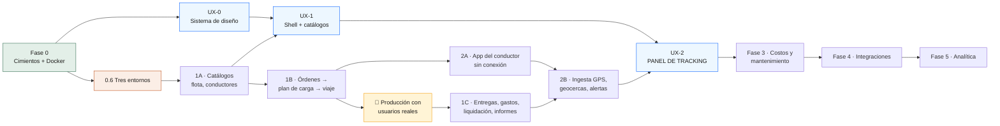

# Plan de construcción — FleetFuel Control

Del contenedor Docker a la implementación del panel de tracking, fase por fase.

**Versión:** 1.1 · **Fecha:** 2026-09-07 · **Ámbito:** proyecto personal

## De dónde sale este plan

Este documento no inventa alcance. Reordena y hace ejecutable lo que ya está
decidido en tres fuentes, y cuando las tres se contradicen lo dice en voz alta:

| Fuente | Qué aporta | Dónde |
|---|---|---|
| Arquitectura §19 «Secuencia de construcción» | Las 6 fases, sus duraciones y el orden interno de la Fase 1 | `architec-cisterna.html#/arquitectura/fases` |
| PRD §26 «Implementación por fases» | Los módulos de negocio de cada fase | `documentos.html#cisterna.md` |
| Spec UX/UI · Panel de Tracking v1.0 | 24 fichas de componente, tokens, estados, modelo de datos | `#/spec/ux-tablero` (34 fichas) |
| `README.md` de este repo | Lo que la Fase 0 ya entregó | `/home/app/fleetfuel/README.md` |

Consola completa: <http://10.0.0.193:8000/>

---

## Cómo se lee y cómo se sigue

Cada fase trae cuatro cosas, y **las cuatro son obligatorias**:

- **Puerta de entrada** — lo que tiene que ser cierto para empezar. Si no se
  cumple, la fase no arranca; no se «arranca en paralelo mientras tanto».
- **Entregables** — casillas marcables. Es el checklist de trabajo.
- **Criterio de salida** — cómo se demuestra que terminó, con el comando que lo
  prueba. Una fase sin criterio de salida verificable no está terminada, está
  abandonada.
- **El riesgo de esta fase** — el modo de fallo concreto, no una lista genérica.

Estados: `✅ hecho` · `🟡 parcial` · `⬜ pendiente` · `🚧 bloqueado`

---

## El punto que le da forma a este plan

La petición natural es «de Docker hasta el UX/UI», en línea recta. **No se puede.**

El modelo de datos del spec (`#/spec/ux-modelo-datos`) define un `Shipment` con
cinco bloques, y cada uno nace en una fase distinta:

```
Shipment {
  id, status, partnerId, partnerName   →  Fase 1A/1B  (clientes, viajes)
  vehicle { capacityPct, overloaded }  →  Fase 1A     (vehículos, cisternas)
  driver  { chatChannelId, lastSeenAt }→  Fase 1A + 2 (conductores + chat)
  eta     { remainingSec, delaySec }   →  Fase 2      (necesita GPS real)
  route   { stops, polyline }          →  Fase 1B/1C  (plan de carga, entregas)
  telemetry { lat, lng, stale }        →  Fase 2      (posiciones_gps)
  photos  PhotoReport[]                →  Fase 2      (fotografías del conductor)
  requests RouteRequest[]              →  Fase 2      (NO existe en el PRD ⚠)
}
```

De ahí salen las dos consecuencias que estructuran todo lo demás:

**1. El panel de tracking no puede ir al final.** Si se deja para después de la
Fase 5, hay tres fases enteras sin una sola pantalla y el §19 ya advierte a qué
sabe eso: *«un mes que no produce ninguna pantalla visible, y por eso suele
recortarse»*. Por eso hay **dos carriles**: producto/backend y UX/UI, con
compuertas explícitas entre ellos.

**2. El panel de tracking tampoco puede ir al principio.** Sin `posiciones_gps`
no hay punto azul en el mapa, sin `viajes` no hay tarjetas y sin entregas no hay
paradas. Lo que **sí** se puede adelantar es todo lo que no depende de datos: los
tokens, los 24 componentes con sus estados, los skeletons y el recorrido de
teclado. Eso es la Fase UX-0, y corre en paralelo desde el día uno.

### Mapa de dependencias



La compuerta 🏁 es del §19 y es innegociable: **1B llega a producción con
usuarios reales antes de que empiece 1C.** *«Un recorrido operativo completo y en
uso enseña más sobre lo que falta que tres módulos a medio terminar.»*

---

## Estado al 2026-09-12

| Fase | Duración §19 | Estado | Comentario |
|---|---|---|---|
| 0 · Cimientos | 30 d | ✅ **cerrada** | 2026-09-06. Los tres entornos en pie, observabilidad recogiendo y respaldos verificándose solos |
| UX-0 · Sistema de diseño | ~15 d | 🟢 **código completo** | 24/24 componentes, contraste AA en CI. Falta Noka y la revisión humana |
| 1A · Catálogos | 25 d | ✅ **cerrada** | Criterio de salida verificado DESDE LA UI: alta de cliente, conductor, vehículo y cisterna con compartimentos, las cuatro en auditoría |
| UX-1 · Shell y catálogos | — | 🟢 **código completo** | 3 columnas, 5 breakpoints, estado en la URL, CRUD de los 6 catálogos. Los **5 breakpoints ya se verifican solos** en CI (`sonda-responsive.mjs`, 2026-09-12). Falta la revisión humana y los objetivos táctiles de 44 px |
| 1B · Órdenes → viaje | 35 d | 🟢 **código verificado** | 5 tablas, exclusiones del §5.1, 14 rutas, 16 pruebas y el flujo completo recorrido desde la UI. Falta solo la compuerta de producción |
| 1C · Entregas, liquidación | 30 d | 🟢 **código completo** | Entregas, conciliación, gastos, informes y liquidaciones (2026-09-07), más `cargas_terminal`, la pantalla `/operacion/despacho`, la **bitácora del viaje (§7.15)** y el recorrido de navegador (2026-09-12). El criterio de salida se recorre entero DESDE LA UI. Falta el viaje real |
| 2A · App del conductor | 45 d | 🟡 **lado servidor hecho** | `eventos_viaje` y `POST /sincronizacion/eventos` (2026-09-07). Falta la app: React Native, SQLite, cola de salida, checklists, fotografías y firma |
| 2B · GPS, geocercas, alertas | 30 d | 🟡 **casi cerrada** | `posiciones_gps` particionada, ingesta por lotes, `stale`, km PostGIS, geocercas y 8 de 10 alertas (2026-09-07). Faltan desvío de ruta y parada no autorizada, el WebSocket y el **cálculo de ETA** |
| 2C · Solicitudes de ruta | — | ✅ **cerrada** | 5 rutas, permisos y la regla de que quien pide no resuelve. Chat descartado (opción 3) |
| **ADM · Administración (§5 y §21)** | — | 🟢 **código completo** | Fase NUEVA, creada el 2026-09-12: no estaba en el §19 ni en este plan. Usuarios, roles y permisos, inscripción del segundo factor, refresco de sesión, cierre con revocación, **auditoría y dispositivos**. Recorrido de navegador propio en CI |
| UX-2 · Panel de tracking | ~35 d | ⬜ | Compuerta dura: 2B. Le falta además el ETA, que hoy no existe en ningún sitio |
| 3 · Costos y mantenimiento | 55 d | ⬜ | Aquí viven `consumo_combustible_vehiculo` (§7.16) y `mantenimientos` (§7.19), y con ellas las reglas 3 y 11 del §11 |
| 4 · Integraciones | 45 d | ⬜ | |
| 5 · Analítica | 40 d | ⬜ | |

**Auditoría TDD del 2026-09-12.** Se midió el backend contra el §7 y el §11 del
PRD ejecutando la suite, no leyendo el plan. Resultado: **16 de las 19 tablas
del §7** existían y **16 de las 20 reglas del §11** se aplicaban. De los cuatro
huecos, tres eran Fase 3 y uno no estaba en ninguna fase — ver abajo. Cerrados
ese mismo día el hueco sin fase (§7.13) y la regla 13.

**Auditoría TDD del FRONTEND, el mismo día.** Mismo método —medir contra el PRD
y contra la superficie de API viva, ejecutando la suite— aplicado a la interfaz.
Resultado: de las **115 rutas** del backend, unas **40 no tenían pantalla**, y
nueve módulos enteros estaban a cero. Ver abajo.

### El hueco que no estaba en ninguna fase — la ADMINISTRACIÓN (§5 y §21)

La Fase 0.3 construyó auth, RBAC y MFA en el backend. **La interfaz nunca los
recibió**, y el plan no tenía una sola casilla para ellos: UX-1 entrega «CRUD de
catálogos», UX-2 entrega el panel, y la administración no era de nadie. Es
exactamente la forma del hueco de `cargas_terminal`: lo que no está escrito en
ninguna fase no lo echa de menos nadie.

`grep` de cada módulo del backend contra `frontend/src`, fuera de las pruebas:
`/usuarios` (3 rutas), `/roles` y `/permisos` (4), `/dispositivos` (2),
`/auditoria` (1) — **cero referencias**. Y de las 6 rutas de `/auth`, la
interfaz llamaba **sólo a `/auth/login`**.

Lo que eso significaba en la práctica, y por qué bloqueaba la compuerta 🏁:

1. **Un usuario nuevo no podía entrar.** La pantalla detectaba
   `debeInscribirMfa` y sólo mostraba un aviso: no había nada que llamara a
   `mfa/iniciar`. Los recorridos e2e lo inscribían **por la API**, que es por lo
   que nadie lo echaba de menos. La compuerta pendiente es «producción con
   usuarios reales» y no se podía dar de alta a uno sin curl.
2. **La sesión duraba 15 minutos y no se refrescaba.** El `refreshToken` se
   guardaba y no se usaba nunca; el primer 401 echaba a la persona a `/entrar`,
   a media pantalla de despacho.
3. **Cerrar sesión era sólo local.** El refresco seguía vivo en Redis hasta
   vencer, así que quien tuviera una copia podía seguir pidiendo tokens de
   acceso después del «cierre».

**Cerrado el 2026-09-12**, en orden TDD y con recorrido de navegador propio
(`e2e/recorrido-admin.mjs`, primero en CI). Entregado: pantalla de inscripción
del segundo factor dentro de `/entrar` —con el token de inscripción EN MEMORIA,
nunca en `localStorage`, porque no es una sesión—, `/administracion/usuarios`
con el MFA de cada cuenta visible y la suspensión motivada del §21,
`/administracion/roles` con el editor de permisos por módulo, refresco
automático con una sola llamada en vuelo, y cierre de sesión que revoca en el
servidor.

**El recuento «N de M permisos» de la pantalla de roles no es adorno**: es la
cifra que habría delatado el primer día el Administrador de 11 permisos sobre 48
que estuvo días en producción. Nadie lo vio porque no había dónde verlo.

### Los 5 breakpoints, que nadie había vuelto a mirar

El criterio de salida de UX-1 dice «el shell aguanta los 5 breakpoints con datos
reales». Se verificó a mano al escribir el shell — y desde entonces entraron
**nueve pantallas** sin que nadie volviera a abrirlas en un móvil. Ninguna
prueba de componente puede verlo: jsdom no tiene ancho ni calcula layout.

`e2e/sonda-responsive.mjs` recorre las **14 pantallas en los 5 anchos** (70
combinaciones) y encontró **seis layouts rotos**, uno de ellos a 1100 px —un
portátil corriente— en la pantalla de usuarios recién escrita.

**La causa de fondo era una sola, y no era la que parecía.** Las tablas anchas
no caben, eso se sabía; se envolvieron en `TablaDesplazable` para que se
desplace la tabla y no la página. Pero la ventana **seguía** desplazándose con
las tablas ya contenidas. El culpable era un `<span class="solo-lectores">` —
texto invisible, de un píxel, para lectores de pantalla— dentro de cada botón de
la tabla: al ser `position: absolute` sin ningún ancestro posicionado, **escapaba
de la caja con scroll** y arrastraba el ancho del documento. Nueve píxeles que
nadie ve moviendo el layout de todos. Se cerró con un `position: relative` en la
caja.

Queda **un aviso abierto, y es de diseño**: hay objetivos táctiles por debajo de
los 44 px que pide el spec en TODAS las pantallas, incluidas las de UX-0/UX-1
(botones de 32 y 36 px, 81 de ellos sólo en órdenes). Es un cambio de altura en
el sistema de diseño, no un arreglo puntual, así que **se reporta y no se
cambia**: entra en la revisión humana pendiente de UX-0.

### El otro hallazgo: la raíz del dominio servía una maqueta

`src/app/page.tsx` redirigía a `/tablero`, el boceto de UX-2: seis envíos
inventados, sin `ShellApp` —**sin puerta de sesión**— y con un menú de botones
sin `href`. Verificado con Playwright contra producción: `/` → `/tablero`, no
pedía sesión, enseñaba los datos falsos y ofrecía **0 enlaces** a la aplicación
real. Mientras tanto el login mandaba a `/operacion/ordenes`: el tablero estaba
huérfano por los dos lados.

Ninguna de las 293 pruebas lo veía —`Tablero.spec.tsx` prueba la maqueta, y
pasa— y ningún recorrido tampoco, porque los tres hacían `goto('/entrar')`
directo. **La ruta que nadie prueba es la que todo el mundo escribe en la
barra.**

Arreglado: la raíz lleva a `/operacion/ordenes`, el tablero va detrás de la
puerta y se declara boceto en pantalla. La puerta se extrajo de `ShellApp` a
`PuertaDeSesion` porque vivía acoplada a la navegación y por eso sólo protegía
lo que llevaba menú.

### Lo que queda sin pantalla, y a qué fase pertenece

Cerrado el mismo 2026-09-12 todo lo que era de Fase 1 o de §21:

| API viva | Rutas | Estado |
|---|---|---|
| `/eventos` (bitácora del viaje, §7.15) | 5 | ✅ `SeccionBitacora` en `/operacion/despacho` |
| `/conductores/licencias-por-vencer` | 1 | ✅ `AvisoLicencias` sobre la tabla de conductores |
| `/auditoria` (§21) | 1 | ✅ `/administracion/auditoria` |
| `/dispositivos` (§21) | 2 | ✅ `/administracion/dispositivos` |
| `/gps` (flota, recorrido, kilómetros) | 4 | ⬜ UX-2 / 2B |
| `/alertas` (§22) | 5 | ✅ `/operacion/alertas` (2026-09-13): listar, evaluar, reconocer y resolver. `GET /alertas/:id` no hace falta: la lista trae cada alerta entera |
| `/geocercas` | 4 | ⬜ UX-2 / 2B — el backend sólo las CREA (no hay edición ni baja), y dibujarlas pide el mapa de UX-2 |
| `/solicitudes-ruta` (§2C) | 5 | 🟡 `/operacion/solicitudes` (2026-09-13): la bandeja de pendientes y resolver. Pedir un cambio es de la app del conductor (2A); el historial por viaje, del panel de UX-2 |
| `/sincronizacion`, `/gps/posiciones` | 2 | — ingesta de máquina, no pantalla (2A) |

**Por qué las dos bandejas NO esperaron a UX-2** (2026-09-13): la compuerta de
UX-2 es 2B, y lo que 2B no tiene —el ETA, el WebSocket, las alertas de desvío—
lo necesita el PANEL, no una lista de alertas ni una cola de permisos. Esperar
dejaba al Despachador sin forma de resolver una solicitud y a nadie leyendo las
alertas que el backend genera desde el 07-09. Un sistema de alertas que nadie
lee no alerta de nada.

**Lo que aportó cada pantalla sobre su API**, que es el criterio con el que se
decidió qué construir y no sólo «pintar el endpoint»:

- **Bitácora**: que la verificación de integridad se pueda VER. El backend
  expuso `/integridad` como ruta propia porque «un hash que nadie puede
  comprobar desde fuera no prueba nada a nadie» — y sin pantalla seguía sin
  comprobarlo nadie. Y que anular no parezca borrar: el evento original se
  queda, marcado, con su corrección al lado.
- **Licencias**: la consulta es `fecha <= hoy + N días`, así que en la misma
  lista vienen las que van a vencer y **las que ya vencieron**. No son lo mismo:
  una vencida no es un aviso con margen, es un conductor que hoy no puede
  conducir. La API no las separa; la pantalla sí.
- **Auditoría**: traducir dos JSON a QUÉ CAMBIÓ, incluido el campo que
  desaparece. Un volcado de JSON enseña el dato sin responder la pregunta que
  trae quien abre una auditoría.
- **Dispositivos**: enseñar `sesionesCortadas`. Revocar toca dos mundos —la
  marca en Postgres impide futuros logins, el borrado en Redis corta las
  sesiones ya abiertas— y ese número es la diferencia entre «lo hice» y
  «funcionó».

### El hueco que no estaba en ninguna fase — §7.13 `cargas_terminal`

El flujo `orden → plan de carga → viaje → entrega` se dio por cerrado sin la
tabla que registra **qué pasó en la terminal**. No se ve desde dentro porque la
máquina de estados sí tiene `cargando → cargado`: el viaje pasaba por la
terminal y no dejaba constancia.

Lo que eso rompía, y que ninguna prueba podía ver porque todas medían módulos
por separado:

- **La regla 18 estaba a medias.** «Todo sello debe quedar asociado a una carga
  y verificarse en la entrega»: sólo existía la verificación, contra nada.
  `entregas.sello_recibido` lo escribía quien registraba la entrega y
  `estado_sello` lo elegía esa misma persona entre tres valores. Un control en
  el que el mismo actor aporta el dato y su veredicto no controla nada, y la
  alerta `sello_inconsistente` sólo disparaba cuando alguien ya había confesado.
- **La merma del §10.5 se medía contra el plan.** `entregas.volumen_cargado` se
  copiaba de `plan_carga.volumen_planificado`, así que el combustible que nunca
  llegó a subir al camión se le contaba de menos al conductor. En un sistema
  cuyo riesgo declarado es el fraude de volumen, era la resta importante con el
  sustraendo equivocado.
- **El rol «Operador de carga» llevaba semanas sin trabajo.** El §5 le da
  literalmente «confirma volúmenes cargados y sellos», y tenía cuatro permisos
  de lectura. Un rol vacío es tan buena señal de un hueco como una tabla sin
  filas.

Cerrado el 2026-09-12: migración 1803, 5 rutas, 32 pruebas y el servicio al
100 % en las cuatro métricas. Ahora la coincidencia del sello **la decide el
sistema**; lo que sigue siendo humano es la integridad física —un precinto
reventado sólo lo ve quien está delante del camión—, así que se puede empeorar
el veredicto a mano y nunca mejorarlo.

### El 500 que el recorrido de navegador destapó

`PATCH /viajes/:id/estado` devolvía un **500 con el nombre de una restricción
dentro** cada vez que arrancar un viaje pisaba a otro de la misma cisterna.

`periodo` es `tstzrange(coalesce(fecha_inicio, fecha_programada), fecha_fin)`, y
pasar a `desplazamiento_terminal` estampa `fecha_inicio = now()`: el periodo se
estira desde este momento hasta el fin previsto. `crear` y `actualizar`
envolvían su consulta en `traducirSolapamiento`; `cambiarEstado` no — y era el
único de los tres donde el periodo cambia sin que nadie toque una fecha.

No lo había visto ninguna prueba porque **ninguna había movido un viaje más allá
de `autorizado` reutilizando una cisterna**: la suite de superficie estrena una
en cada bloque, que es justo lo que una flota real no hace. Lo encontró el
recorrido de navegador el primer día que existió.

### Y la regla 13, que era un comentario y no un bloqueo

«Los documentos vencidos bloquearán la asignación» no se aplicaba en ninguna
parte. Existía la alerta `licencia_por_vencer`, y su propio comentario decía
que la regla 13 BLOQUEA — y a continuación implementaba sólo el aviso.

Cerrada en `autorizar` y no en `crear`, porque §5 le da al Despachador
«autoriza salida y verifica documentos» y porque una licencia puede caducar
entre el día que se planifica el viaje y el día que sale: comprobarlo sólo al
asignar dejaría salir en marzo un viaje armado en enero. Cubre la licencia del
conductor y la calibración de la cisterna, con el mismo corte que usa la alerta
(`fecha < current_date`) para que el aviso y el bloqueo no se contradigan.

Repositorio: `main` en `67acab8`, respaldado en
`git@github.com:JosueObando/fleetfuel.git` (privado).

**FleetFuel se sirve en <https://fleetfuel.jop.lat>** desde el 2026-09-06, con
TLS válido, un solo origen y el login con freno de fuerza bruta y registro de
intentos fallidos. Verificado de extremo a extremo: `/entrar` 200 en
25 ms, `/api/salud` con `postgres: ok` y `redis: ok`, los chunks del bundle
200, el 80 redirigiendo con 301, y `POST /api/auth/login` devolviendo 401 con
credenciales falsas. Los puertos 4200 y 3200 ya **no** son alcanzables desde la
LAN; el 4100 de desarrollo sigue abierto a propósito.

**Producción está levantada** en esta misma máquina desde el 2026-09-04, con
sus cuatro servicios sanos y separados de desarrollo en nombre, volúmenes, red
y puertos (4200/3200 frente a 4100/3100). La base y Redis no se publican.

**1A queda cerrada el 2026-09-04.** Su criterio de salida se verificó donde
lo pide el §26 —desde la interfaz, no por API— con el recorrido automatizado
`frontend/e2e/recorrido.mjs`: entra por la pantalla de login y da de alta un
cliente, un conductor, un vehículo y una cisterna con dos compartimentos. Las
cuatro altas quedan en `auditoria` con autor y hora, y el navegador no reporta
ningún error de consola.

**De UX-0 sigue faltando lo que necesita una persona:** los `.woff2` de Noka
(los títulos caen en Montserrat) y el recorrido del kit junto al spec.

En marcha: `http://10.0.0.193:3100` (interfaz) · `:4100/api` (API) ·
`:8000` (portal de documentos).

---

# FASE 0 · Cimientos y Docker

> **Objetivo.** Las cinco garantías que el §19 llama *«las cinco cosas más caras
> de añadir tarde en todo el proyecto»*. No produce ninguna pantalla.

**Puerta de entrada:** ninguna. Es el arranque.

### 0.1 · Docker y entorno de desarrollo — ✅

- [x] `docker-compose.yml` con backend, Postgres 16 + PostGIS 3.4 y Redis 7
- [x] `Dockerfile` multietapa, con `target: development` que conserva
      devDependencies y `src/` — es lo que permite correr seeds y pruebas de
      integración *dentro* del contenedor
- [x] `.env.example` con los secretos separados de `.env`

```bash
cd /home/app/fleetfuel
sg docker -c "docker compose up -d --build"
sg docker -c "docker compose exec backend npm run seed"
curl -s localhost:4100/api/salud | jq
```

> El usuario `app` está en el grupo `docker` pero la sesión es anterior al
> cambio: hay que envolver con `sg docker -c "…"`. `sudo` pide contraseña
> interactiva.

### 0.2 · Esquema multiempresa con RLS — ✅

- [x] `empresa_id` en toda tabla de negocio, con política RLS (ADR 003)
- [x] **Dos roles de base de datos**: `DATABASE_USER` (dueño, migra) y
      `DATABASE_APP_USER` (sujeto a RLS, sin `DELETE`). En Postgres el dueño de
      una tabla evade sus propias políticas: conectar la app como dueño anularía
      el aislamiento **sin un solo síntoma**. `main.ts` lo comprueba al arrancar
      y se niega a levantar
- [x] `fn_login_resolver` como `SECURITY DEFINER` — el login necesita saber la
      empresa antes de tener contexto, y esta función devuelve sólo eso
- [x] Verificado: 8 tablas con política; `migrations`, `permisos` y
      `spatial_ref_sys` sin ella, correctamente

### 0.3 · Auth, RBAC y MFA — ✅

- [x] JWT: acceso 15 min / refresco 7 días revocable en Redis
- [x] RBAC con permisos granulares, **sin rol de paso libre** — deliberado: el
      riesgo del negocio no es el robo de datos sino el *fraude de volumen* (§7),
      y la separación entre quien captura la carga y quien captura la entrega
      desaparece en cuanto un rol puede hacerlo todo
- [x] MFA TOTP obligatorio para Administrador, Finanzas y Auditor, con sesión de
      inscripción restringida (sin `refreshToken`, por diseño)
- [x] Registro y revocación remota de dispositivos

### 0.4 · Auditoría e idempotencia — ✅

- [x] Interceptor global → tabla append-only (§21, §4)
- [x] `Idempotency-Key` obligatoria en todo `POST`, con huella del cuerpo
      (ADR 004). Excepciones explícitas con `@SinIdempotencia()`

### 0.5 · CI con Postgres real — ✅

- [x] `.github/workflows/ci.yml` ejecutado paso a paso en clúster limpio,
      incluido `migration:revert`

### 0.6 · Los tres entornos — ✅ **5 de 5**

- [x] Servidor de **prueba** provisionado — 2026-09-06, replanteando lo que
      este documento daba por imposible: `docker-compose.prueba.yml`, puertos
      4300/3300, base, volúmenes y secretos propios
- [x] Servidor de **producción** — redefinido el 2026-09-04 a esta misma
      máquina; compose propio levantado y verificado de extremo a extremo
- [x] **Respaldo** automático de Postgres con restauración probada —
      `ops/respaldo-postgres.sh`, diario a las 02:00 por timer de systemd,
      rotación 7+4. Falta el destino fuera de este host (ver los bloqueos)
- [x] Nginx + Let's Encrypt como reverse proxy (§8: «nuevo») — cerrado el
      2026-09-06: host creado en NPM, TLS del comodín, puertos cerrados a la LAN
- [x] Observabilidad: **Grafana + Loki + Prometheus** (§8) — autoalojada,
      2026-09-06. `docker-compose.observabilidad.yml` y `ops/observabilidad.md`

> **Nginx, al 2026-09-06.** Decidida la topología de **un solo origen**: el
> frontend en `/` y la API en `/api` bajo el mismo host. `NEXT_PUBLIC_API_URL`
> pasó de `http://10.0.0.193:4200/api` a `/api` y el frontend se reconstruyó:
> verificado que la IP absoluta ya no aparece en el bundle. Sin eso el proxy
> habría sido decorativo, porque esa URL se hornea en el JavaScript del
> navegador y el cliente habría seguido llamando al 4200 directamente.
>
> La configuración está escrita en `ops/nginx-fleetfuel.conf` y **aplicada**
> en el NPM de 10.0.0.19 según `ops/proxy-inverso.md`: el host reenvía `/` al
> 3200 y una Custom Location `/api` al 4200, sin `Cache Assets`.
>
> **Let's Encrypt sí es posible, y ya está en marcha.** Corregido el
> 2026-09-06: en el NPM hay un comodín `*.jop.lat` de Let's Encrypt válido
> hasta el 8 de noviembre de 2026, emitido por reto **DNS-01** —que solo
> comprueba un TXT en el DNS y nunca visita el servidor, así que la IP privada
> no estorba—. `fleetfuel.jop.lat` ya resuelve y queda cubierto sin emitir
> nada. El descarte anterior razonaba sobre el reto HTTP-01, que sí exige
> alcanzabilidad; era un error.
>
> **Puerta trasera cerrada** el 2026-09-06 con `ops/cerrar-puertos-produccion.sh`
> y su unidad de systemd. No con `ufw`, que aquí **miente**: Docker mete su DNAT
> en PREROUTING y el tráfico va por FORWARD, mientras ufw trabaja en INPUT, así
> que el puerto seguiría abierto a toda la LAN y `ufw status` diría que está
> denegado. El enganche correcto es la cadena `DOCKER-USER`, emparejando con
> `conntrack --ctorigdstport` porque allí el DNAT ya ocurrió.
>
> **Y ahí hubo una segunda trampa, que dejó la URL pública colgada desde
> las 04:11 hasta que se diagnosticó.**
> `--ctorigdstport` identifica la CONEXIÓN, no el paquete: casa en los dos
> sentidos. El SYN del proxy pasaba, pero el SYN-ACK que el contenedor le
> devuelve sale con `src=172.19.0.x` —que no es 10.0.0.19— y la propia regla lo
> descartaba. La conexión se quedaba en `SYN_RECV` y la URL pública se colgaba
> **sin un solo error en ningún log**, porque un `DROP` no devuelve RST. El
> síntoma era idéntico a «el host de NPM no está creado», que era falso. Lo
> arregla `--ctdir ORIGINAL` (commit `67acab8`), que limita la regla al sentido
> de ida; el script purga la regla vieja antes de instalar la nueva, porque
> dejarla puesta anula el arreglo.
>
> **El freno del login, resuelto en el backend** (2026-09-06). El `limit_req`
> del proxy se había quitado con `--quitar-limite` para que el host de NPM
> cargara —la zona se declara dentro del CT y eso pide un `ssh root@` que desde
> aquí no autentica—, y detrás no había nada. Verificado entonces: **42
> intentos seguidos, 42 respuestas 401, ni un 429, ni una línea en ningún
> registro.**
>
> Se eligió resolverlo en el backend y no en el proxy: es más lento que nginx,
> pero no depende del acceso al CT y no se pierde al recrear el host en NPM.
> Ver el bloqueo 3, cerrado.
>
> **El servidor de prueba SÍ lo da esta máquina** (2026-09-06). Este documento
> decía lo contrario, y era la misma clase de error que el descarte de Let's
> Encrypt: una conclusión heredada que nadie volvió a comprobar. Producción se
> redefinió a esta misma máquina el 04-09 y funciona; un tercer proyecto de
> Compose es mecánicamente lo mismo, y para un entorno de prueba la objeción de
> compartir disco pesa aún menos, porque sus datos son desechables por
> definición.
>
> Sirve para ensayar el despliegue antes de tocar producción: correr
> `migration:run` contra datos con forma y arrancar la MISMA etapa `production`
> de la imagen. Hoy ese ensayo se hacía en producción, que es donde no se debe
> descubrir que una migración falla. Construye con etiqueta `:prueba` y no
> reutiliza `:prod`: compartirla haría que reconstruir para probar cambiara, en
> silencio, la imagen que producción levantaría en su siguiente reinicio.
>
> **Lo único que no reproduce** es el origen único: sin proxy delante, su
> bundle lleva la URL absoluta y por tanto sí hay CORS, donde producción no
> tiene. Un fallo de CORS es de los pocos que este entorno no puede atrapar.
> Se arregla creando `prueba.jop.lat` en el NPM, que el comodín ya cubre.

> **Observabilidad, cerrada el 2026-09-06.** Grafana + Loki + Prometheus
> autoalojados, unos 400 MB de RAM. Se descartó Sentry + Better Stack: los
> registros llevan correos, IPs y cuerpos de error, y sacarlos de la red es una
> decisión que este sistema no necesita tomar.
>
> Lo primero que hubo que arreglar fue que **el backend no registraba ni una
> petición HTTP** —214 líneas en producción, todas de arranque—. Ahora cada una
> deja una línea JSON con su `idPeticion`, que vuelve al cliente en
> `X-Request-Id`. Nunca el cuerpo: el del login lleva la clave y el TOTP. Y lo
> genera un *middleware*, no un interceptor, porque cuando un guard rechaza
> —el 401 del JWT, el 429 del freno— la excepción sube y el interceptor no
> llega a correr: justo el tráfico que más interesa sería el único invisible.
>
> **Queda fuera, con motivo:** las métricas por contenedor. cAdvisor es
> incompatible con el almacenamiento de Docker 29 y producía métricas
> etiquetadas con el cgroup en crudo en vez del nombre — datos correctos e
> ilegibles. Detalle completo en `ops/observabilidad.md`.
>
> **Nueve alertas** (2026-09-06), aprovisionadas por fichero: producción caída,
> un entorno interno caído, certificado a menos de 21 días, respaldo fallido
> esta noche, respaldo sin terminar bien en 26 h, disco >85 %, memoria <10 %,
> 5xx sostenidos y el freno del login mordiendo. Verificadas parando el backend
> de desarrollo: disparó a los 6 minutos y se resolvió sola al restaurarlo.
>
> Las dos del respaldo forman escalera a propósito: aviso la misma noche por
> `fleetfuel_respaldo_exito`, y crítica al día siguiente por antigüedad. La
> segunda cubre además lo que la primera no puede —el timer parado o la máquina
> apagada—, porque en esos dos casos la métrica no se escribe y no hay fallo que
> detectar, sólo una ausencia.
>
> Dos decisiones que las sostienen. Las **sondas van desde fuera**, por la misma
> URL que usa un usuario, y recorren DNS, proxy, TLS, cortafuegos y aplicación:
> es lo que habría visto el cuelgue de esta mañana, que ningún healthcheck
> interno vio porque el backend estaba sano. Y el **respaldo afirma su éxito**
> con una métrica en vez de que se busque la ausencia de un error en los
> registros — la ausencia también se produce con el timer parado o la máquina
> caída, y en los tres casos parece que todo va bien.
>
> **El canal, cerrado** (2026-09-06): ntfy autoalojado en el 3450, con un
> traductor de treinta líneas en medio porque Grafana no deja dar forma al
> cuerpo de un webhook y, conectado directo, al móvil llegaba su JSON en crudo.
> Se descartó el correo (no hay SMTP) y los tipos de contacto nativos que llegan
> a un móvil (Telegram, Discord, Slack, Pushover) por ser todos de terceros — el
> mismo motivo por el que la observabilidad entera es autoalojada.
>
> Verificado extremo a extremo parando el backend de desarrollo: disparó a los
> 5 min y la notificación llegó a los 6 con título, causa y qué mirar; al
> restaurarlo llegó la resolución con prioridad baja, que no despierta a nadie.
>
> Por el camino apareció un fallo que la propia prueba habría tapado: el título
> viajaba en una cabecera HTTP, que no es UTF-8, y las seis alertas con tilde
> llegaban como «Producci<?>n no responde» — con ntfy respondiendo 200, así que
> no había rastro en ningún registro. La alerta elegida para probar era una de
> las dos sin tilde. Se arregló publicando por cuerpo JSON.

### 0.7 · Respaldo del repositorio — ✅ (2026-09-03)

- [x] Remoto de git configurado y `push` verificado
- [x] `fase-0-cierre` fusionada a `main`

> Cerrado el 2026-09-03. Remoto privado en `JosueObando/fleetfuel`, autenticado
> con llave ed25519 propia del repositorio (`~/.ssh/id_ed25519_fleetfuel`, con
> `IdentitiesOnly` en `~/.ssh/config`) y la host key de GitHub verificada contra
> la huella publicada. `fase-0-cierre` se fusionó a `main` por fast-forward y se
> subió: `main` = `c8b00f4`, 3 commits, local y remoto idénticos.
>
> Este documento estaba **fuera de git** hasta el mismo cierre. Antes de subir
> se verificó que `.env` está en `.gitignore` y nunca entró al historial, y que
> ningún archivo versionado trae credenciales.

**Criterio de salida de la Fase 0**

```bash
sg docker -c "docker compose exec -T backend npm run typecheck"        # 0 errores
sg docker -c "docker compose exec -T backend npm test"                 # 0 fallos
sg docker -c "docker compose exec -T backend npm run test:integracion" # 0 fallos
curl -sf http://localhost:4300/api/salud                               # 200 en PRUEBA
curl -sf https://fleetfuel.jop.lat/api/salud                           # 200 en PRODUCCIÓN
git remote -v && git push origin main                                  # remoto vivo
```

**Ejecutado el 2026-09-06:** typecheck limpio, 54 pruebas unitarias y 53 de
integración en verde, los tres entornos respondiendo y el remoto al día.

**El riesgo de esta fase era** darla por cerrada con 4 de 5 — las fases
siguientes producen pantallas, la presión por avanzar aumenta y el 0.6 no se
vuelve más fácil, sólo más caro. No se corrió: se cerró entera antes de
empezar 1C.

---

# FASE UX-0 · Sistema de diseño

> **Casillas revisadas el 2026-09-13** contra el CÓDIGO, no contra la tabla de
> estado: se marcaron las que tienen evidencia (24 directorios en
> `src/componentes`, tokens y anchos en `tokens.css`, `auditar:contraste` en CI,
> `sonda-responsive.mjs`, el kit con sus estados). Siguen abiertas las que no se
> pueden demostrar: Noka no está en el repositorio, los iconos son trazos propios
> «al estilo» UIcons y no UIcons, los skeletons del panel son de UX-2, y no hay
> revisión humana ni recorrido de teclado grabado.

> **Objetivo.** Convertir el spec en código que compila, **antes** de que existan
> datos que pintar. Todo lo aquí listado se puede construir con datos falsos.

**Puerta de entrada:** ninguna — corre en paralelo con 0.6 y 1A.

### Entregables

- [x] Proyecto Next.js 16 + React 19 + TypeScript 5.6 (§8 «Stack recomendado»)
- [x] **Tokens como variables CSS** (`#/spec/ux-tokens-color`), en la columna
      del spec, no en la del original oscuro:
      `--action #0660FF` · `--bg-base #F4F6F7` · `--bg-surface #FCFDFD` ·
      `--fg-strong #21252B` · `--fg-default #363B43` · `--fg-muted #627485` ·
      `--border-subtle #D9D9D9` · éxito `#2ECC71` · aviso `#F59E0B` · error `#E53935`
- [x] Escala tipográfica, radios y transiciones (`#/spec/ux-tokens-forma`).
      Radios del spec: `--radius-sm 8` inputs y chips · `--radius-card 16` tarjetas ·
      `--radius-pill` botones — **los botones del spec son pastilla, no radio 8**
- [ ] Tipografía a dos voces: **Noka** sólo en títulos e ID de envío,
      **Montserrat** en todo lo demás. **Nunca Prometo en UI**
- [x] Los **24 componentes** de las fichas, cada uno con sus 6 estados
      (reposo, hover, foco, activo, deshabilitado, cargando):
  - [x] Chrome y navegación (5): `BrandBlock` `NavItem` `NavGroup` `IconToolbar` `DashedCTA`
  - [x] Panel de tracking (8): `PanelHeader` `FilterChip` `SegmentedControl` `ShipmentCard` `StatusBadge` `MetricStack` `RouteTimeline` `VehicleThumb`
  - [x] Panel de detalle (11): `DetailHeader` `Button` `Tabs` `CapacityGauge` `SectionHeader` `MapView` `MapControl` `PhotoStrip` `PhotoCard` `ActionTile` `RequestList`
- [ ] Iconos UIcons Rounded vía componente `Icon`: 20 px en nav, 16 px en botones
- [ ] **Skeletons por panel, no globales** (`#/spec/ux-estados-pantalla`):
      6 tarjetas con bloques de 12/60/72 px y shimmer de 1.2 s. Sin spinner de
      página. Si pasa de 3 s, «Cargando la flota…» debajo
- [ ] Copy en español de Panamá, trato de tú, orientado al resultado:
      «Seguimiento», «Filtrar por socios», «Llamar al conductor», «Cambiar ruta»
- [ ] Accesibilidad (`#/spec/ux-accesibilidad`): contraste verificado —
      **incluida la corrección de `fg-tertiary`**—, recorrido de teclado completo
      sin trampas de foco, regiones vivas, `prefers-reduced-motion`
- [x] Storybook (o equivalente) con los 24 × 6 estados navegables

**Criterio de salida**

- [ ] Un revisor abre el kit junto a `#/spec/ux-tablero` y recorre los 23 globos:
      cada uno tiene su componente construido y sus 6 estados visibles
- [x] Auditoría de contraste automatizada en CI, 0 fallos AA
- [ ] Recorrido de teclado grabado de extremo a extremo, sin trampas

**El riesgo de esta fase:** construir los componentes con el tema **oscuro** del
original. El spec trae una columna de equivalencias entera
(`#/spec/ux-equivalencias-mupa`)
precisamente porque dentro del ecosistema municipal el tema es **claro por
defecto**, con jerarquía por sombras azuladas en vez de por luminancia. Repintar
24 componentes después es rehacerlos.

---

# FASE 1 · Control operativo

> **Objetivo.** El recorrido operativo completo: de la orden al viaje, y del
> viaje a la liquidación. Es la fase que convierte el sistema en algo usable.

## 1A · Catálogos, flota y conductores — 25 d

**Puerta de entrada:** Fase 0 cerrada **incluido 0.6**.

- [ ] Clientes · Estaciones · Productos
- [ ] Vehículos · Cisternas (con compartimentos y capacidad por compartimento)
- [ ] Conductores (con licencia, vencimientos y calibración)
- [ ] Habilitar `btree_gist` para las restricciones de exclusión del §5.1 — la
      Fase 0 ya dejó la extensión puesta pero no la usa
- [ ] Cada `POST` con `Idempotency-Key`; cada entidad con `empresa_id` y RLS
- [ ] Permisos de negocio añadidos a los 12 roles del §5

**Criterio de salida:** un operador da de alta una cisterna con sus
compartimentos, un conductor y un cliente desde la UI, y la auditoría registra
las tres altas con autor, fecha y valores.

## UX-1 · Shell de la aplicación y pantallas de catálogo

**Puerta de entrada:** UX-0 terminada · 1A con endpoints vivos.

- [x] Layout de tres columnas (`#/spec/ux-layout`): sidebar 228 px fijo ·
      Tracking 540 px · Detalle 672 px flexible (`flex:1`, mínimo 560).
      **La ventana no scrollea**; scrollean sólo los dos paneles
- [x] Sidebar colapsado a 72 px por debajo de 1280
- [x] Los 5 breakpoints (`#/spec/ux-responsive`): ≥1600 · 1280–1599 ·
      1024–1279 · 768–1023 maestro/detalle conmutado · <768 tab bar de 5 destinos
- [x] CRUD de catálogos sobre los componentes de UX-0
- [x] **Estado de la vista reflejado en la URL** —
      `?partners=a,b&show=active&selected=SD-…` — para que sea compartible y
      recargable sin pérdida de estado

**Criterio de salida:** el shell aguanta los 5 breakpoints con datos reales de
catálogo y la URL restaura la vista exacta tras recargar.

## 1B · Órdenes → plan de carga → viaje — 35 d

**Puerta de entrada:** 1A cerrada.

- [x] Órdenes
- [x] Plan de carga, con asignación por compartimento
- [x] Viajes, con la máquina de estados del §8 del PRD
- [x] Restricción de exclusión: una cisterna o un conductor **no pueden estar en
      dos viajes que se superpongan** (§5.1)
- [ ] Motor de cálculo y control de concurrencia (§16 de arquitectura)

### 🏁 COMPUERTA · Producción con usuarios reales

**No se empieza 1C hasta que esto sea cierto.** Es una instrucción literal del
§19, no una recomendación.

- [x] `orden → plan de carga → viaje` desplegado en **producción** (2026-09-06)
- [ ] **Uso real**: viajes de verdad recorridos de punta a punta por quien opera
      el sistema
- [ ] Al menos 2 semanas de operación, con los defectos encontrados triados

> **Releída el 2026-09-07.** La versión original de esta compuerta decía
> «usuarios reales de la Alcaldía», y eso venía de una premisa falsa: **esto es
> un proyecto personal.** Tal como estaba escrita era insatisfacible —no hay
> una Alcaldía que ponga usuarios—, así que bloqueaba para siempre en vez de
> proteger algo.
>
> Lo que la compuerta protege SÍ sigue en pie, y no depende de quién sea el
> dueño: un módulo diseñado contra datos imaginados se rehace cuando llegan los
> de verdad. Así que se reescribe en términos que este proyecto puede cumplir
> —uso real, no uso institucional— y se mantiene el listón de las dos semanas.

> *«El módulo de liquidaciones se diseña mucho mejor cuando ya existen viajes
> reales que liquidar.»*

## 1C · Entregas, gastos, liquidación e informes — 30 d

**Puerta de entrada:** la compuerta 🏁 superada.

- [x] **Carga en terminal** — §7.13 completa (2026-09-12), 5 rutas, 32 pruebas.
      La Etapa 5 del §9, que faltaba entera. Es el origen del sello y del
      volumen real contra el que la entrega concilia
- [x] **Entregas** — §7.14 completa, 5 rutas, 25 pruebas (2026-09-07)
- [ ] Evidencia fotográfica y documentos de la entrega — llega con 2A, que es
      donde el conductor captura evidencias (§5)
- [x] **Gastos** — §7.17 completa, 6 rutas, 19 pruebas
- [x] **Liquidaciones** — §7.18 completa y la fórmula del pago combinado del
      §10.7 literal. Calcular, aprobar y pagar son **tres actos con tres
      permisos**, porque el §7.18 les da fechas separadas. NO entra la variación
      de tarifa por ruta, horario, feriado o riesgo: eso es el motor de tarifas
      de la Fase 3, y es justo lo que el uso real va a reformar
- [x] **Conciliación de volúmenes** (§17) y merma con tolerancia — §10.4 y §10.5
- [x] **Reportes básicos (§14)** — operativo, cadena del volumen, mermas por
      conductor/cisterna/producto y recorridos. Los del §14.3 (costo por km,
      rentabilidad) NO: dependen del motor de costos de la Fase 3
- [x] **Su pantalla** — `/operacion/informes` (2026-09-12), 22 pruebas, con el
      estado en la URL para que un informe filtrado se pueda mandar por
      mensaje. Lo que la pantalla añade sobre la API son **las restas**: la
      cadena del §14.2 existe para hacer visible el descuadre, y cuatro sumas
      en fila dejan esa resta a cargo de quien mira

### Por qué esta parte se adelantó a la compuerta, y el resto no

La compuerta protege lo que la operación real puede cambiar de forma. El §19 lo
dice de las liquidaciones —«se diseñan mucho mejor cuando ya existen viajes
reales que liquidar»— y el apartado de riesgo de abajo avisa del coste de
rehacerlas.

**Las entregas no son eso.** Sus campos son los del §7.14 uno a uno, sus
fórmulas las del §10.4 y §10.5, y su comportamiento las reglas 7, 8, 9 y 20 del
§11. Nada de eso se aprende operando: está escrito. Lo que sí espera son gastos,
liquidaciones e informes, que son justo donde la operación enseña.

Una decisión de diseño que conviene conocer antes de tocar el módulo: **no se
bloquea recibir más volumen del que se cargó.** Los medidores de la terminal y
de la estación no coinciden nunca al litro, y rechazar la lectura obliga a quien
captura a redondear hasta que el sistema la acepte. Eso no evita el descuadre,
lo BORRA — y el descuadre es la señal de fraude de volumen que el §7 llama el
riesgo principal de este negocio. Se acepta, se calcula la merma (en valor
absoluto, para ver los dos lados) y la regla 9 la manda a aprobación de otro
rol. El único tope duro es el de la regla 20, y vive en la base.

**Criterio de salida:** un viaje real recorre orden → carga → entrega →
liquidación y cuadra contra la conciliación de volúmenes, con la merma dentro de
tolerancia y la diferencia justificada en auditoría.

- [x] **El recorrido existe y pasa** — `test/recorrido-1c.integracion.ts`
      (2026-09-12): un solo viaje de punta a punta por HTTP, con dos usuarios
      para que las separaciones de responsabilidad se ejerciten de verdad. Una
      orden de 6 000 en dos compartimentos, carga en terminal con medidores que
      no dan redondo (2 990 y 3 010), entregas dentro de tolerancia con sus
      sellos verificados, gasto aprobado por otra mano, y liquidación calculada,
      firmada y pagada por manos distintas. Comprueba que los números se
      ENCADENAN —planificado sale de pedido, cargado de planificado, entregado
      de cargado— y que las cinco entidades dejaron rastro en `auditoria`.
      Hasta ahora `api-superficie` armaba un viaje nuevo por bloque: cada módulo
      podía estar bien y la cadena estar rota, que es exactamente lo que pasaba
      con el sello.
- [ ] **Un viaje REAL**, con datos de verdad y no de una suite. Sigue pendiente,
      y es lo que la compuerta 🏁 protege.
- [x] **La interfaz de 1C** — `/operacion/despacho` (2026-09-12), 40 pruebas.
      Al empezar el día no existía: el frontend tenía pantallas para los seis
      catálogos, órdenes y viajes, y NINGUNA para cargas, entregas, gastos ni
      liquidaciones. 1C estaba cerrada en el backend y sin empezar en el
      frontend, y esa asimetría no estaba escrita en ningún sitio.

      **Una pantalla y no cuatro**, porque una carga, una entrega, un gasto y
      una liquidación son siempre de UN viaje: cuatro listas obligarían a elegir
      el mismo viaje cuatro veces y, peor, dejarían mirar las entregas sin ver
      contra qué carga concilian — que es la relación que 1C existe para
      vigilar. Qué momento está abierto lo dice la máquina de estados del §8.2 y
      no una pestaña.

      Lo que la pantalla NO ofrece es tan deliberado como lo que ofrece: **no
      hay forma de declarar un precinto «intacto»**. La coincidencia la decide
      el servidor contra `cargas_terminal.numero_sello`; lo que se le pregunta a
      la persona es lo único que sólo ella ve —si llegó físicamente roto—, así
      que puede empeorar el veredicto y nunca retirarlo. Un desplegable con las
      tres opciones habría contado la historia contraria.
- [x] **El recorrido de navegador** — `frontend/e2e/recorrido-1c.mjs`, once
      pasos, en CI. Es lo que el §26 pide para cerrar una fase: *desde la
      interfaz*, no por API. Termina comprobando que lo entregado es exactamente
      lo que salió de la terminal y que el panel del §15.5 muestra sus bloques.
- [ ] **Los cuatro bloques del §15.5 que faltan** — consumo, ingreso, costo y
      utilidad. Dependen del motor de costos y de `consumo_combustible_vehiculo`
      (§7.16), que son Fase 3. El panel los nombra en vez de omitirlos: uno al
      que le faltan cuatro sin explicación se lee como terminado y olvidadizo.

**El riesgo de la Fase 1:** construir 1C en paralelo con 1B «para ganar tiempo».
Es exactamente lo que el §19 desaconseja, y el coste no se ve hasta que hay que
rehacer liquidaciones contra un modelo de viaje que la operación real cambió.

---

# FASE 2 · Móvil y GPS

> **Objetivo.** Los datos que el panel de tracking necesita para existir.

## 2A · App del conductor sin conexión — 45 d

**Puerta de entrada:** 1B cerrada.

- [x] **Base de la trazabilidad** (§7.15) — `eventos_viaje` construida el
      2026-09-07, antes que la app y a propósito: un registro de trazabilidad
      añadido tarde nace con un hueco —los meses en que el sistema ya operaba y
      no registraba nada—. Append-only, con corrección en vez de borrado y
      cadena de hashes verificable
- [ ] React Native + Expo (§8)
- [ ] SQLite local (`expo-sqlite`) + **cola de salida** — falta el lado del
      móvil; el del servidor ya está
- [x] **Sincronización idempotente** — `POST /sincronizacion/eventos`
      (2026-09-07). La idempotencia es POR ELEMENTO y no por petición: un
      reintento de cola no reenvía la misma petición, trae lo que no confirmó
      más lo que se acumuló mientras tanto. Éxito parcial con savepoints, para
      que un elemento inválido no atasque la cola ni tumbe a los demás
- [ ] Checklists · Fotografías · Firma digital

## 2B · Ingesta GPS, geocercas y alertas — 30 d

**Puerta de entrada:** 2A con conductores reales enviando datos · 1C cerrada.

- [x] **Tabla `posiciones_gps` particionada por mes** (2026-09-07) — NO estaba
      preparada en Fase 0 pese a lo que decía este plan: no existía. Las
      particiones se crean solas con `fn_asegurar_particion_gps`, en vez de por
      una tarea programada que falla en silencio el día 1 a las 00:00
- [x] **Ingesta por lotes** con `unnest` en una sola sentencia. Falta el
      WebSocket: hoy es HTTP, que es lo que la app de 2A puede usar sin más
- [ ] Polling de respaldo de la lista completa cada 60 s — `GET /gps/flota` ya
      lo sirve; falta el lado del panel
- [x] **Marca `stale`** — calculada al leer y no almacenada: una marca guardada
      estaría obsoleta en cuanto pasara el tiempo, y mantenerla al día exigiría
      justo el proceso que se cae y deja el banner apagado
- [x] **Kilómetros GPS del §10.1** y su diferencia contra el odómetro,
      calculados en PostGIS
- [x] **Geocercas** (2026-09-07) — círculo definido por centro y radio, guardado
      siempre como polígono `geography`: guardar centro+radio obligaría a cada
      consulta a decidir si compara contra un círculo o contra un polígono, y
      esa bifurcación acaba escrita distinto en cada sitio
- [x] **Siete de las ocho alertas** del §22, más tres del listado ampliado:
      exceso de velocidad, pérdida de GPS, sello inconsistente, diferencia de
      volumen, vencimientos, viaje sin cerrar, liquidación pendiente y gasto
      sin comprobante
- [ ] **Desvío de ruta y parada no autorizada** — las dos que faltan, y por el
      mismo motivo: necesitan la RUTA PLANIFICADA como geometría.
      `viajes.ruta_planificada` es texto libre («Vía Centenario»), no una
      polilínea. Inventarle un corredor a partir de las geocercas de sus
      paradas daría falsos positivos en cada desvío legítimo por tráfico, que
      es la forma más rápida de que un despachador desactive las alertas

### 2C · Solicitudes de cambio de ruta — ✅ decidido y cerrado

**No está en el PRD.** Se decidió el 2026-09-07: entra.

El spec define `RouteRequest { type: "detour"|"extra_stop"|"cancel", requestedBy,
reason, state: "pending"|"approved"|"rejected", resolvedBy, resolvedAt }` y el
componente `RequestList` con aprobación y rechazo en línea. En el PRD, «Desvío»
aparece **sólo como alerta detectada** (§22) y como evento del flujo (§9): es
reactivo, no un flujo de aprobación.

También aparece `driver.chatChannelId` en el modelo y un botón de chat en
`MapControl`. **La palabra «chat» no existe en el PRD.**

- [x] **Decisión tomada el 2026-09-07: los dos entran al alcance.**
- [x] `RouteRequest` — tabla `solicitudes_ruta`, 5 rutas, 15 pruebas de servicio
      y el recorrido HTTP. Los tres tipos del spec (`detour`, `extra_stop`,
      `cancel`) y sus tres estados
- [x] Permisos `solicitudesruta:leer/crear/resolver`, repartidos
- [ ] Notificación a la app del conductor — **necesita la Fase 2A**, que es
      donde esa app existe. Lo que falta es el aviso, no el modelo
- [x] Chat · **DIFERIDO** el 2026-09-07: el panel v1 sale sin él. Botón retirado
      de `MapView` y columna `canal_chat` retirada del esquema (migración 1795)

### La regla que hace que `RouteRequest` sea un control y no un formulario

**Quien pide no resuelve**, y va además del permiso: el permiso dice qué puede
hacer un ROL, y la regla dice qué no puede hacer una PERSONA con su propia
solicitud. Un despachador que pide un desvío sigue sin poder aprobárselo aunque
su rol resuelva los de los demás. Sin eso, «solicitud de cambio de ruta» es el
conductor autorizándose el desvío y la traza que deja no prueba nada.

El reparto lo refleja: el **Conductor** pide —es quien está en la carretera y ve
el problema— y el **Despachador** y el **Supervisor de operaciones** resuelven,
que es literalmente lo que el §5 les asigna.

Y no sustituye a la alerta de desvío del §22: aquella es reactiva —el sistema se
entera de que el camión se salió— y ésta es un permiso pedido de antemano. El
desvío que nadie pidió sigue siendo el que más interesa vigilar.

### Chat: lo que el spec NO dice, y por eso queda abierto

El spec pide `driver.chatChannelId` y un botón en `MapControl`. **Eso es todo:**
no define mensajes, ni almacenamiento, ni transporte, ni quién puede escribir a
quién. El identificador está construido —es el mismo campo en cualquiera de los
caminos posibles— pero lo que falta no es código, es una decisión:

1. **Enlace a una mensajería existente** (WhatsApp, Telegram). El campo guarda
   un enlace, el botón lo abre y FleetFuel no almacena ni un mensaje. Es lo más
   barato con diferencia, y lo que ya usa media flota del país. A cambio, la
   conversación queda FUERA de la auditoría del §21 — y en un sistema cuyo
   riesgo declarado es el fraude de volumen, «cámbiame la ruta, te lo digo por
   WhatsApp» es exactamente lo que no debería quedar sin rastro.
2. **Mensajería propia dentro de FleetFuel.** Entra en la auditoría y se ata a
   los permisos, pero es un subsistema entero: tabla de mensajes, tiempo real,
   notificaciones, no leídos, adjuntos. No cabe en 2C; es una fase.
3. **Ninguna de las dos: el botón se quita del spec.** Si toda instrucción al
   conductor tiene que ser auditable, `solicitudes_ruta` ya cubre el caso de
   uso real —pedir y autorizar un cambio— y el chat sobra.

**Elegida la 3 el 2026-09-07.** El panel v1 sale sin chat, y la elección entre 1
y 2 espera a que exista la app del conductor (2A) y se sepa qué hay que decirle
de verdad. Un botón dibujado que abre WhatsApp es la opción que parece gratis y
deja la decisión tomada sin que nadie la tome.

Lo que se retiró, y por qué se retiró en vez de dejarlo esperando:

- **El botón de `MapView`.** Un botón que no hace nada promete una función que
  nadie ha decidido construir. El hueco que deja al quitarlo es lo que mantiene
  la decisión a la vista.
- **La columna `conductores.canal_chat`.** Su significado depende de la decisión
  pendiente: con una mensajería externa sería un teléfono o un enlace; con una
  propia, el identificador interno de un hilo. No son el mismo dato con dos
  nombres. Y una columna así no se queda vacía —alguien la rellena—: si media
  flota apunta ahí números de WhatsApp durante seis meses y luego se elige la
  mensajería propia, ese contenido no se migra, se tira, y hasta que alguien lo
  note el panel muestra un canal que no lleva a ninguna parte.

Cuando la decisión se tome, las dos cosas vuelven con el significado que esa
decisión les dé. Recrearlas cuesta una migración y un botón; desenredar datos
con dos significados cuesta bastante más.

**El caso de uso real ya está cubierto:** pedir un cambio de ruta y que otro lo
autorice, con traza y con la separación de quien pide y quien resuelve, es
`solicitudes_ruta`.

**Criterio de salida de la Fase 2:** un conductor real recorre un viaje con la
app sin cobertura durante un tramo, la cola de salida se drena al recuperar
señal sin duplicar nada, y `posiciones_gps` tiene la traza completa.

---

# FASE UX-2 · Panel de Tracking

> **Objetivo.** La pantalla del spec, con datos reales. Es el entregable que
> cierra el arco completo del plan.

**Puerta de entrada — las cuatro, sin excepción:**

1. UX-0 cerrada (los 24 componentes existen)
2. 1B cerrada (hay viajes que listar)
3. 1C cerrada (hay paradas y entregas para el timeline)
4. 2B cerrada (hay telemetría que pintar)

### Entregables

- [ ] Panel de tracking: `PanelHeader`, `FilterChip` por socio con contador del
      servidor, `SegmentedControl` All/Active/Inactive
- [ ] Lista de `ShipmentCard` con **scroll infinito en páginas de 20**
- [ ] Panel de detalle: `DetailHeader`, `Tabs` de 5 vistas, `CapacityGauge` sobre
      la silueta del vehículo, `PhotoStrip` + `ActionTile`
- [ ] `MapView` con Leaflet 1.9 (§8): ruta, posición actual, nodos de parada y
      encuadre automático
- [ ] Cronómetros de ETA **interpolados en cliente** entre actualizaciones
- [ ] Los 6 estados de pantalla con su copy exacto (`#/spec/ux-estados-pantalla`):
      carga · lista vacía · filtro sin resultados · sin selección · error de
      carga por panel · telemetría caída
- [ ] **Nunca autoseleccionar** un envío en escritorio, salvo por deep link
- [ ] En error de carga: conservar el último dato válido **con marca de hora**
- [ ] Permisos en los 4 puntos de escritura: «Cambiar ruta», «Solicitar foto» y
      aprobar/rechazar exigen rol dispatcher. En rol viewer se muestran
      **deshabilitados con tooltip, no ocultos**
- [ ] `RequestList` — sólo si 2C se aprobó

### Criterio de salida — el checklist de handoff del spec

Las diez verificaciones de `#/spec/ux-handoff`, íntegras:

- [ ] Tokens de color y tipo publicados como variables CSS
- [ ] Los componentes con sus 6 estados en el kit
- [ ] Skeletons implementados **por panel**, no globales
- [ ] Contraste verificado, incluida la corrección de `fg-tertiary`
- [ ] Recorrido de teclado completo sin trampas de foco
- [ ] Estado de la vista reflejado en la URL
- [ ] Comportamiento con telemetría obsoleta probado
- [ ] Truncados verificados con datos máximos
- [ ] Fallback textual de la ruta cuando el mapa falla
- [ ] Permisos por rol validados en los 4 puntos de escritura

**El riesgo de esta fase:** el fallback del mapa. Es la única casilla del handoff
que exige que la pantalla siga siendo útil **cuando su elemento central no
carga**, y es la primera que se recorta cuando aprieta la fecha. Un panel de
operaciones sin fallback deja al despachador sin saber dónde está el camión
justo el día que el proveedor de tiles se cae.

---

# FASES 3 – 5

Con el arco cerrado, el resto es el §26 del PRD sin reordenar.

## Fase 3 · Costos y mantenimiento — 55 d

Aquí viven las **dos últimas tablas del §7 que faltan**. La auditoría del
2026-09-12 las nombró porque el plan las daba por implícitas y no las escribía
en ninguna parte, y una tabla del modelo de datos que no aparece en ninguna fase
es exactamente como se perdió `cargas_terminal`.

- [ ] **§7.16 `consumo_combustible_vehiculo`** — el combustible del CABEZAL, que
      no es el producto transportado. De ella cuelgan el §10.2 y el §10.3, y la
      **regla 11**: «no se puede cerrar un viaje sin registrar el combustible
      consumido o justificar su ausencia». Hoy cerrar un viaje no comprueba nada
- [ ] **§7.19 `mantenimientos`** — y con ella la **regla 3**: «no se puede
      despachar una unidad con mantenimiento crítico vencido». El gancho ya está
      puesto: `documentosAlDia` en `viajes.service.ts` es donde entra, junto a
      la licencia y la calibración que ya bloquean
- [ ] Motor de costos y rentabilidad · costo por kilómetro · depreciación
- [ ] Mantenimiento preventivo y reparaciones
- [ ] Los informes del §14.3 y §14.5, que dependen de las dos tablas de arriba
- [ ] Indicadores ejecutivos (§24)

## Fase 4 · Integraciones — 45 d
- [ ] Terpelo · terminal de carga · medidores · sensores
- [ ] Tarjetas de combustible · contabilidad · facturación

## Fase 5 · Analítica avanzada — 40 d
- [ ] Predicción de mantenimiento y de tiempos de entrega
- [ ] Optimización de rutas
- [ ] Detección de consumo anómalo y de posibles pérdidas
- [ ] Asignación automática de cisternas

---

## Trazabilidad: spec UX ↔ backend

Para revisar en cada corte que no se está construyendo pantalla sin dato ni dato
sin pantalla.

| Campo del `Shipment` | Origen en backend | Fase | Ficha del spec |
|---|---|---|---|
| `id`, `status` | `viajes` + máquina de estados §8 | 1B | `ux-shipmentcard`, `ux-statusbadge` |
| `partnerId`, `partnerName` | `clientes` | 1A | `ux-filterchip` |
| `vehicle.type`, `plate` | `vehiculos`, `cisternas` | 1A | `ux-vehiclethumb` |
| `vehicle.capacityPct`, `overloaded` | compartimentos + plan de carga | 1A/1B | `ux-capacitygauge` |
| `driver.*` | `conductores` | 1A | `ux-detailheader` |
| `driver.chatChannelId` | ⚠ **no existe en el PRD** | 2C | `ux-mapcontrol` |
| `driver.lastSeenAt` | telemetría | 2B | `ux-detailheader` |
| `eta.*` | cálculo sobre GPS | 2B | `ux-metricstack` |
| `route.stops`, `polyline` | plan de carga + entregas | 1B/1C | `ux-routetimeline` |
| `route.changedBy` | auditoría (§21) | 0 ✅ | `ux-routetimeline` |
| `telemetry.*`, `stale` | `posiciones_gps` particionada | 2B | `ux-mapview` |
| `photos[]` | fotografías del conductor | 2A | `ux-photostrip`, `ux-photocard` |
| `requests[]` | ⚠ **no existe en el PRD** | 2C | `ux-requestlist` |

Dos filas con ⚠. Ese es todo el alcance que el spec añadió sobre el PRD, y está
concentrado en un solo sitio a propósito: es más barato decidirlo ahora que
descubrirlo cuando `RequestList` ya esté maquetado.

---

## Los bloqueos: dos abiertos, uno cerrado

Los dos que quedan son decisiones, no código. El tercero apareció el 2026-09-06
al verificar el proxy y se cerró el mismo día, porque el sistema ya estaba
publicado y no podía esperar.

1. **Cómo se respaldan los datos.** *(parcial al 2026-09-04)* Ya existe el
   mecanismo: `ops/respaldo-postgres.sh`, diario a las 02:00 por timer de
   systemd, con verificación por restauración real y rotación 7+4. Lo que
   falta es el **destino fuera de este host**. El CT de nginx (10.0.0.19)
   comparte disco físico con esta VM, así que no sirve: una falla de ese
   disco se lleva original y copia. Queda aplazado por decisión del
   2026-09-04.
   Detalle original: Decidido el 2026-09-03 que desarrollo y
   producción vivirán en esta misma máquina, con sólo desarrollo por ahora. Eso
   resuelve el "dónde" del 0.6, pero traslada el peso al respaldo: hoy no existe
   ninguno de Postgres —sin cron, sin timer, sin dumps— y `db_data` es un volumen
   Docker sin copia. Con dev y prod compartiendo disco, el respaldo sustituye al
   aislamiento que se cede al no tener servidores separados. Falta decidir la
   ventana de pérdida tolerable y a dónde sale la copia, que debe salir de esta
   máquina.
2. **Si `RouteRequest` y el chat entran al alcance.** Bloquea a UX-2, pero se
   decide ahora porque cambia el modelo de datos de la Fase 2.

3. ~~**`POST /auth/login` no tiene ningún freno.**~~ **Cerrado el 2026-09-06**,
   las dos mitades. Se eligió el **backend** sobre el proxy: más lento que
   nginx, pero no depende del acceso al CT ni se pierde al recrear el host.

   - **Frenar** (`bb9ccbf`) — dos frenos con nombre, contados en Redis con un
     script Lua: `login-cuenta` 5/min por (IP, cuenta) y `login-ip` 30/min por
     IP, con bloqueo de 5 minutos. Son dos porque uno solo no vale: por IP a
     secas deja fuera a una oficina entera detrás de NAT, y por cuenta a secas
     se le escapa el barrido. En memoria tampoco valdría —el contador moriría
     con el proceso y el compose reinicia solo—, y en Lua porque
     `GET`+`INCR` desde Node deja huecos por los que pasan las peticiones
     concurrentes, que es la forma exacta del ataque.
   - **Ver** (`3d01520`) — tabla `intentos_login`, aparte de `auditoria` y por
     dos razones: `auditoria.empresa_id` es `NOT NULL` con RLS y un intento
     contra un correo inexistente no pertenece a ninguna empresa; y la
     auditoría se escribe *dentro* de la transacción de la petición para que se
     revierta si falla, que aquí es justo lo contrario de lo que hace falta. El
     rol de la aplicación tiene `INSERT` y **no** `SELECT`: escribe y no lee, y
     tampoco puede borrar.

   Verificado en producción por la URL pública: el intento queda registrado con
   la IP del **cliente** (10.0.0.193), no la del proxy — que es la prueba de
   que la cadena `trust proxy` → freno → registro está entera.

   Queda para cuando exista la pantalla: **cómo se consulta** el registro, con
   qué permiso y con qué visibilidad entre empresas. Hoy se lee con `psql`, que
   es lo que hace un operador mirando un ataque.

> **Cerrado:** el respaldo del repositorio (0.7), el 2026-09-03. El proxy
> inverso con TLS (0.6), el 2026-09-06.

---

*Fuentes: arquitectura §19 · PRD §26 · Spec UX/UI Panel de Tracking v1.0 ·
`README.md` de Fase 0. Consola: <http://10.0.0.193:8000/>*
