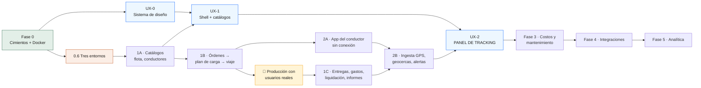

# Plan de construcción — FleetFuel Control

Del contenedor Docker a la implementación del panel de tracking, fase por fase.

**Versión:** 1.0 · **Fecha:** 2026-08-30 · **Ámbito:** Alcaldía de Panamá

## De dónde sale este plan

Este documento no inventa alcance. Reordena y hace ejecutable lo que ya está
decidido en tres fuentes, y cuando las tres se contradicen lo dice en voz alta:

| Fuente | Qué aporta | Dónde |
|---|---|---|
| Arquitectura §19 «Secuencia de construcción» | Las 6 fases, sus duraciones y el orden interno de la Fase 1 | `architec-cisterna.html#/arquitectura/fases` |
| PRD §26 «Implementación por fases» | Los módulos de negocio de cada fase | `documentos.html#cisterna.md` |
| Spec UX/UI · Panel de Tracking v1.0 | 24 fichas de componente, tokens, estados, modelo de datos | `#/spec/ux-tablero` (34 fichas) |
| `README.md` de este repo | Lo que la Fase 0 ya entregó | `/home/app/fleetfuel/README.md` |

Consola completa: <http://10.0.0.193:8000/>

---

## Cómo se lee y cómo se sigue

Cada fase trae cuatro cosas, y **las cuatro son obligatorias**:

- **Puerta de entrada** — lo que tiene que ser cierto para empezar. Si no se
  cumple, la fase no arranca; no se «arranca en paralelo mientras tanto».
- **Entregables** — casillas marcables. Es el checklist de trabajo.
- **Criterio de salida** — cómo se demuestra que terminó, con el comando que lo
  prueba. Una fase sin criterio de salida verificable no está terminada, está
  abandonada.
- **El riesgo de esta fase** — el modo de fallo concreto, no una lista genérica.

Estados: `✅ hecho` · `🟡 parcial` · `⬜ pendiente` · `🚧 bloqueado`

---

## El punto que le da forma a este plan

La petición natural es «de Docker hasta el UX/UI», en línea recta. **No se puede.**

El modelo de datos del spec (`#/spec/ux-modelo-datos`) define un `Shipment` con
cinco bloques, y cada uno nace en una fase distinta:

```
Shipment {
  id, status, partnerId, partnerName   →  Fase 1A/1B  (clientes, viajes)
  vehicle { capacityPct, overloaded }  →  Fase 1A     (vehículos, cisternas)
  driver  { chatChannelId, lastSeenAt }→  Fase 1A + 2 (conductores + chat)
  eta     { remainingSec, delaySec }   →  Fase 2      (necesita GPS real)
  route   { stops, polyline }          →  Fase 1B/1C  (plan de carga, entregas)
  telemetry { lat, lng, stale }        →  Fase 2      (posiciones_gps)
  photos  PhotoReport[]                →  Fase 2      (fotografías del conductor)
  requests RouteRequest[]              →  Fase 2      (NO existe en el PRD ⚠)
}
```

De ahí salen las dos consecuencias que estructuran todo lo demás:

**1. El panel de tracking no puede ir al final.** Si se deja para después de la
Fase 5, hay tres fases enteras sin una sola pantalla y el §19 ya advierte a qué
sabe eso: *«un mes que no produce ninguna pantalla visible, y por eso suele
recortarse»*. Por eso hay **dos carriles**: producto/backend y UX/UI, con
compuertas explícitas entre ellos.

**2. El panel de tracking tampoco puede ir al principio.** Sin `posiciones_gps`
no hay punto azul en el mapa, sin `viajes` no hay tarjetas y sin entregas no hay
paradas. Lo que **sí** se puede adelantar es todo lo que no depende de datos: los
tokens, los 24 componentes con sus estados, los skeletons y el recorrido de
teclado. Eso es la Fase UX-0, y corre en paralelo desde el día uno.

### Mapa de dependencias



La compuerta 🏁 es del §19 y es innegociable: **1B llega a producción con
usuarios reales antes de que empiece 1C.** *«Un recorrido operativo completo y en
uso enseña más sobre lo que falta que tres módulos a medio terminar.»*

---

## Estado al 2026-09-06

| Fase | Duración §19 | Estado | Comentario |
|---|---|---|---|
| 0 · Cimientos | 30 d | 🟡 **4 de 5** | 0.7 cerrado. Del 0.6 quedan Nginx en NPM y la observabilidad |
| UX-0 · Sistema de diseño | ~15 d | 🟢 **código completo** | 24/24 componentes, contraste AA en CI. Falta Noka y la revisión humana |
| 1A · Catálogos | 25 d | ✅ **cerrada** | Criterio de salida verificado DESDE LA UI: alta de cliente, conductor, vehículo y cisterna con compartimentos, las cuatro en auditoría |
| UX-1 · Shell y catálogos | — | 🟢 **código completo** | 3 columnas, 5 breakpoints, estado en la URL, CRUD de los 6 catálogos |
| 1B · Órdenes → viaje | 35 d | 🟢 **código verificado** | 5 tablas, exclusiones del §5.1, 14 rutas, 16 pruebas y el flujo completo recorrido desde la UI. Falta solo la compuerta de producción |
| 1C · Entregas, liquidación | 30 d | ⬜ | Después de producción |
| 2A · App del conductor | 45 d | ⬜ | |
| 2B · GPS, geocercas, alertas | 30 d | ⬜ | |
| UX-2 · Panel de tracking | ~35 d | ⬜ | Compuerta dura: 2B |
| 3 · Costos y mantenimiento | 55 d | ⬜ | |
| 4 · Integraciones | 45 d | ⬜ | |
| 5 · Analítica | 40 d | ⬜ | |

Repositorio: `main` en `2de1dff`, respaldado en
`git@github.com:JosueObando/fleetfuel.git` (privado). Local y remoto idénticos.

**Producción está levantada** en esta misma máquina desde el 2026-09-04, con
sus cuatro servicios sanos y separados de desarrollo en nombre, volúmenes, red
y puertos (4200/3200 frente a 4100/3100). La base y Redis no se publican.

**1A queda cerrada el 2026-09-04.** Su criterio de salida se verificó donde
lo pide el §26 —desde la interfaz, no por API— con el recorrido automatizado
`frontend/e2e/recorrido.mjs`: entra por la pantalla de login y da de alta un
cliente, un conductor, un vehículo y una cisterna con dos compartimentos. Las
cuatro altas quedan en `auditoria` con autor y hora, y el navegador no reporta
ningún error de consola.

**De UX-0 sigue faltando lo que necesita una persona:** los `.woff2` de Noka
(los títulos caen en Montserrat) y el recorrido del kit junto al spec.

En marcha: `http://10.0.0.193:3100` (interfaz) · `:4100/api` (API) ·
`:8000` (portal de documentos).

---

# FASE 0 · Cimientos y Docker

> **Objetivo.** Las cinco garantías que el §19 llama *«las cinco cosas más caras
> de añadir tarde en todo el proyecto»*. No produce ninguna pantalla.

**Puerta de entrada:** ninguna. Es el arranque.

### 0.1 · Docker y entorno de desarrollo — ✅

- [x] `docker-compose.yml` con backend, Postgres 16 + PostGIS 3.4 y Redis 7
- [x] `Dockerfile` multietapa, con `target: development` que conserva
      devDependencies y `src/` — es lo que permite correr seeds y pruebas de
      integración *dentro* del contenedor
- [x] `.env.example` con los secretos separados de `.env`

```bash
cd /home/app/fleetfuel
sg docker -c "docker compose up -d --build"
sg docker -c "docker compose exec backend npm run seed"
curl -s localhost:4100/api/salud | jq
```

> El usuario `app` está en el grupo `docker` pero la sesión es anterior al
> cambio: hay que envolver con `sg docker -c "…"`. `sudo` pide contraseña
> interactiva.

### 0.2 · Esquema multiempresa con RLS — ✅

- [x] `empresa_id` en toda tabla de negocio, con política RLS (ADR 003)
- [x] **Dos roles de base de datos**: `DATABASE_USER` (dueño, migra) y
      `DATABASE_APP_USER` (sujeto a RLS, sin `DELETE`). En Postgres el dueño de
      una tabla evade sus propias políticas: conectar la app como dueño anularía
      el aislamiento **sin un solo síntoma**. `main.ts` lo comprueba al arrancar
      y se niega a levantar
- [x] `fn_login_resolver` como `SECURITY DEFINER` — el login necesita saber la
      empresa antes de tener contexto, y esta función devuelve sólo eso
- [x] Verificado: 8 tablas con política; `migrations`, `permisos` y
      `spatial_ref_sys` sin ella, correctamente

### 0.3 · Auth, RBAC y MFA — ✅

- [x] JWT: acceso 15 min / refresco 7 días revocable en Redis
- [x] RBAC con permisos granulares, **sin rol de paso libre** — deliberado: el
      riesgo del negocio no es el robo de datos sino el *fraude de volumen* (§7),
      y la separación entre quien captura la carga y quien captura la entrega
      desaparece en cuanto un rol puede hacerlo todo
- [x] MFA TOTP obligatorio para Administrador, Finanzas y Auditor, con sesión de
      inscripción restringida (sin `refreshToken`, por diseño)
- [x] Registro y revocación remota de dispositivos

### 0.4 · Auditoría e idempotencia — ✅

- [x] Interceptor global → tabla append-only (§21, §4)
- [x] `Idempotency-Key` obligatoria en todo `POST`, con huella del cuerpo
      (ADR 004). Excepciones explícitas con `@SinIdempotencia()`

### 0.5 · CI con Postgres real — ✅

- [x] `.github/workflows/ci.yml` ejecutado paso a paso en clúster limpio,
      incluido `migration:revert`

### 0.6 · Los tres entornos — 🟡 **3 de 5**

- [ ] Servidor de **prueba** provisionado
- [x] Servidor de **producción** — redefinido el 2026-09-04 a esta misma
      máquina; compose propio levantado y verificado de extremo a extremo
- [x] **Respaldo** automático de Postgres con restauración probada —
      `ops/respaldo-postgres.sh`, diario a las 02:00 por timer de systemd,
      rotación 7+4. Falta el destino fuera de este host (ver los bloqueos)
- [ ] Nginx + Let's Encrypt como reverse proxy (§8: «nuevo») — 🟡 **parcial**
- [ ] Observabilidad: Grafana+Loki+Prometheus, o Sentry+Better Stack (§8)

> **Nginx, al 2026-09-06.** Decidida la topología de **un solo origen**: el
> frontend en `/` y la API en `/api` bajo el mismo host. `NEXT_PUBLIC_API_URL`
> pasó de `http://10.0.0.193:4200/api` a `/api` y el frontend se reconstruyó:
> verificado que la IP absoluta ya no aparece en el bundle. Sin eso el proxy
> habría sido decorativo, porque esa URL se hornea en el JavaScript del
> navegador y el cliente habría seguido llamando al 4200 directamente.
>
> La configuración está escrita y **probada** en `ops/nginx-fleetfuel.conf`
> (nginx desechable en el 8081: `/entrar` 200, `/api/salud` 200, login POST
> 200 con la puerta de MFA activa). `ops/proxy-inverso.md` especifica lo que
> hay que crear en el NPM de 10.0.0.19. **Queda por aplicar allí**, y falta
> decidir la política de límite del login.
>
> **Let's Encrypt sigue imposible:** 10.0.0.19 es IP privada sin dominio
> público y la validación exige un nombre resoluble desde Internet. Mientras
> tanto las credenciales viajan en claro por la LAN municipal.
>
> **Puerta trasera abierta:** 3200 y 4200 escuchan en `0.0.0.0`, así que hoy se
> puede llamar a la API saltándose el proxy. Se cierra con `ufw` restringiendo
> a 10.0.0.19; requiere `sudo`, o sea una persona.
>
> El servidor de **prueba** es lo único del §19 que esta máquina no da.

### 0.7 · Respaldo del repositorio — ✅ (2026-09-03)

- [x] Remoto de git configurado y `push` verificado
- [x] `fase-0-cierre` fusionada a `main`

> Cerrado el 2026-09-03. Remoto privado en `JosueObando/fleetfuel`, autenticado
> con llave ed25519 propia del repositorio (`~/.ssh/id_ed25519_fleetfuel`, con
> `IdentitiesOnly` en `~/.ssh/config`) y la host key de GitHub verificada contra
> la huella publicada. `fase-0-cierre` se fusionó a `main` por fast-forward y se
> subió: `main` = `c8b00f4`, 3 commits, local y remoto idénticos.
>
> Este documento estaba **fuera de git** hasta el mismo cierre. Antes de subir
> se verificó que `.env` está en `.gitignore` y nunca entró al historial, y que
> ningún archivo versionado trae credenciales.

**Criterio de salida de la Fase 0**

```bash
npm run typecheck && npm test && npm run test:integracion   # 0 fallos
curl -sf https://<host-prueba>/api/salud                    # 200 en PRUEBA
git remote -v && git push origin main                       # remoto vivo
```

**El riesgo de esta fase:** darla por cerrada con 4 de 5. Las fases siguientes
producen pantallas y la presión por avanzar aumenta; el punto 0.6 no se vuelve
más fácil, sólo más caro.

---

# FASE UX-0 · Sistema de diseño

> **Objetivo.** Convertir el spec en código que compila, **antes** de que existan
> datos que pintar. Todo lo aquí listado se puede construir con datos falsos.

**Puerta de entrada:** ninguna — corre en paralelo con 0.6 y 1A.

### Entregables

- [ ] Proyecto Next.js 16 + React 19 + TypeScript 5.6 (§8 «Stack recomendado»)
- [ ] **Tokens como variables CSS** (`#/spec/ux-tokens-color`), en la columna
      MUPA, no en la del original oscuro:
      `--action #0660FF` · `--bg-base #F4F6F7` · `--bg-surface #FCFDFD` ·
      `--fg-strong #21252B` · `--fg-default #363B43` · `--fg-muted #627485` ·
      `--border-subtle #D9D9D9` · éxito `#2ECC71` · aviso `#F59E0B` · error `#E53935`
- [ ] Escala tipográfica, radios y transiciones (`#/spec/ux-tokens-forma`).
      Radios MUPA: `--radius-sm 8` inputs y chips · `--radius-card 16` tarjetas ·
      `--radius-pill` botones — **los botones MUPA son pastilla, no radio 8**
- [ ] Tipografía a dos voces: **Noka** sólo en títulos e ID de envío,
      **Montserrat** en todo lo demás. **Nunca Prometo en UI**
- [ ] Los **24 componentes** de las fichas, cada uno con sus 6 estados
      (reposo, hover, foco, activo, deshabilitado, cargando):
  - [ ] Chrome y navegación (5): `BrandBlock` `NavItem` `NavGroup` `IconToolbar` `DashedCTA`
  - [ ] Panel de tracking (8): `PanelHeader` `FilterChip` `SegmentedControl` `ShipmentCard` `StatusBadge` `MetricStack` `RouteTimeline` `VehicleThumb`
  - [ ] Panel de detalle (11): `DetailHeader` `Button` `Tabs` `CapacityGauge` `SectionHeader` `MapView` `MapControl` `PhotoStrip` `PhotoCard` `ActionTile` `RequestList`
- [ ] Iconos UIcons Rounded vía componente `Icon`: 20 px en nav, 16 px en botones
- [ ] **Skeletons por panel, no globales** (`#/spec/ux-estados-pantalla`):
      6 tarjetas con bloques de 12/60/72 px y shimmer de 1.2 s. Sin spinner de
      página. Si pasa de 3 s, «Cargando la flota…» debajo
- [ ] Copy en español de Panamá, trato de tú, orientado al resultado:
      «Seguimiento», «Filtrar por socios», «Llamar al conductor», «Cambiar ruta»
- [ ] Accesibilidad (`#/spec/ux-accesibilidad`): contraste verificado —
      **incluida la corrección de `fg-tertiary`**—, recorrido de teclado completo
      sin trampas de foco, regiones vivas, `prefers-reduced-motion`
- [ ] Storybook (o equivalente) con los 24 × 6 estados navegables

**Criterio de salida**

- [ ] Un revisor abre el kit junto a `#/spec/ux-tablero` y recorre los 23 globos:
      cada uno tiene su componente construido y sus 6 estados visibles
- [ ] Auditoría de contraste automatizada en CI, 0 fallos AA
- [ ] Recorrido de teclado grabado de extremo a extremo, sin trampas

**El riesgo de esta fase:** construir los componentes con el tema **oscuro** del
original. El spec trae una columna MUPA entera (`#/spec/ux-equivalencias-mupa`)
precisamente porque dentro del ecosistema municipal el tema es **claro por
defecto**, con jerarquía por sombras azuladas en vez de por luminancia. Repintar
24 componentes después es rehacerlos.

---

# FASE 1 · Control operativo

> **Objetivo.** El recorrido operativo completo: de la orden al viaje, y del
> viaje a la liquidación. Es la fase que convierte el sistema en algo usable.

## 1A · Catálogos, flota y conductores — 25 d

**Puerta de entrada:** Fase 0 cerrada **incluido 0.6**.

- [ ] Clientes · Estaciones · Productos
- [ ] Vehículos · Cisternas (con compartimentos y capacidad por compartimento)
- [ ] Conductores (con licencia, vencimientos y calibración)
- [ ] Habilitar `btree_gist` para las restricciones de exclusión del §5.1 — la
      Fase 0 ya dejó la extensión puesta pero no la usa
- [ ] Cada `POST` con `Idempotency-Key`; cada entidad con `empresa_id` y RLS
- [ ] Permisos de negocio añadidos a los 12 roles del §5

**Criterio de salida:** un operador da de alta una cisterna con sus
compartimentos, un conductor y un cliente desde la UI, y la auditoría registra
las tres altas con autor, fecha y valores.

## UX-1 · Shell de la aplicación y pantallas de catálogo

**Puerta de entrada:** UX-0 terminada · 1A con endpoints vivos.

- [ ] Layout de tres columnas (`#/spec/ux-layout`): sidebar 228 px fijo ·
      Tracking 540 px · Detalle 672 px flexible (`flex:1`, mínimo 560).
      **La ventana no scrollea**; scrollean sólo los dos paneles
- [ ] Sidebar colapsado a 72 px por debajo de 1280
- [ ] Los 5 breakpoints (`#/spec/ux-responsive`): ≥1600 · 1280–1599 ·
      1024–1279 · 768–1023 maestro/detalle conmutado · <768 tab bar de 5 destinos
- [ ] CRUD de catálogos sobre los componentes de UX-0
- [ ] **Estado de la vista reflejado en la URL** —
      `?partners=a,b&show=active&selected=SD-…` — para que sea compartible y
      recargable sin pérdida de estado

**Criterio de salida:** el shell aguanta los 5 breakpoints con datos reales de
catálogo y la URL restaura la vista exacta tras recargar.

## 1B · Órdenes → plan de carga → viaje — 35 d

**Puerta de entrada:** 1A cerrada.

- [ ] Órdenes
- [ ] Plan de carga, con asignación por compartimento
- [ ] Viajes, con la máquina de estados del §8 del PRD
- [ ] Restricción de exclusión: una cisterna o un conductor **no pueden estar en
      dos viajes que se superpongan** (§5.1)
- [ ] Motor de cálculo y control de concurrencia (§16 de arquitectura)

### 🏁 COMPUERTA · Producción con usuarios reales

**No se empieza 1C hasta que esto sea cierto.** Es una instrucción literal del
§19, no una recomendación.

- [ ] `orden → plan de carga → viaje` desplegado en **producción**
- [ ] Usuarios reales de la Alcaldía operando viajes reales
- [ ] Al menos 2 semanas de operación, con los defectos encontrados triados

> *«El módulo de liquidaciones se diseña mucho mejor cuando ya existen viajes
> reales que liquidar.»*

## 1C · Entregas, gastos, liquidación e informes — 30 d

**Puerta de entrada:** la compuerta 🏁 superada.

- [ ] Entregas, con evidencia fotográfica y documentos
- [ ] Gastos
- [ ] Liquidaciones, con los cálculos del §10
- [ ] Conciliación de volúmenes (§17 de arquitectura) y merma con tolerancia
- [ ] Reportes básicos (§14)

**Criterio de salida:** un viaje real recorre orden → carga → entrega →
liquidación y cuadra contra la conciliación de volúmenes, con la merma dentro de
tolerancia y la diferencia justificada en auditoría.

**El riesgo de la Fase 1:** construir 1C en paralelo con 1B «para ganar tiempo».
Es exactamente lo que el §19 desaconseja, y el coste no se ve hasta que hay que
rehacer liquidaciones contra un modelo de viaje que la operación real cambió.

---

# FASE 2 · Móvil y GPS

> **Objetivo.** Los datos que el panel de tracking necesita para existir.

## 2A · App del conductor sin conexión — 45 d

**Puerta de entrada:** 1B cerrada.

- [ ] React Native + Expo (§8)
- [ ] SQLite local (`expo-sqlite`) + **cola de salida**
- [ ] Sincronización idempotente contra la infraestructura del ADR 004 — la
      Fase 0 ya dejó la firma de todo `POST` preparada para esto
- [ ] Checklists · Fotografías · Firma digital

## 2B · Ingesta GPS, geocercas y alertas — 30 d

**Puerta de entrada:** 2A con conductores reales enviando datos · 1C cerrada.

- [ ] Tabla `posiciones_gps` **particionada por mes** (§5.2) — preparada en Fase 0
- [ ] Ingesta por WebSocket, cadencia de 5 s (`#/spec/ux-modelo-datos`)
- [ ] Polling de respaldo de la lista completa cada 60 s
- [ ] Marca `stale` en telemetría, para el banner de telemetría caída
- [ ] Geocercas
- [ ] Las 8 alertas del §22: desvío de ruta, exceso de velocidad, parada no
      autorizada, pérdida de GPS, sello inconsistente, diferencia de volumen,
      merma sobre tolerancia, vencimientos

### ⚠ 2C · Solicitudes de cambio de ruta — ALCANCE NUEVO

**Esto no está en el PRD y hay que decidirlo antes de que UX-2 empiece.**

El spec define `RouteRequest { type: "detour"|"extra_stop"|"cancel", requestedBy,
reason, state: "pending"|"approved"|"rejected", resolvedBy, resolvedAt }` y el
componente `RequestList` con aprobación y rechazo en línea. En el PRD, «Desvío»
aparece **sólo como alerta detectada** (§22) y como evento del flujo (§9): es
reactivo, no un flujo de aprobación.

También aparece `driver.chatChannelId` en el modelo y un botón de chat en
`MapControl`. **La palabra «chat» no existe en el PRD.**

- [ ] **Decisión requerida:** ¿entran ambos al alcance, o el panel v1 sale sin
      `RequestList` ni chat?
- [ ] Si entran: entidad, endpoints, permisos y notificación a la app del conductor
- [ ] Si no entran: marcarlos como diferidos en el spec, no dejarlos dibujados

**Criterio de salida de la Fase 2:** un conductor real recorre un viaje con la
app sin cobertura durante un tramo, la cola de salida se drena al recuperar
señal sin duplicar nada, y `posiciones_gps` tiene la traza completa.

---

# FASE UX-2 · Panel de Tracking

> **Objetivo.** La pantalla del spec, con datos reales. Es el entregable que
> cierra el arco completo del plan.

**Puerta de entrada — las cuatro, sin excepción:**

1. UX-0 cerrada (los 24 componentes existen)
2. 1B cerrada (hay viajes que listar)
3. 1C cerrada (hay paradas y entregas para el timeline)
4. 2B cerrada (hay telemetría que pintar)

### Entregables

- [ ] Panel de tracking: `PanelHeader`, `FilterChip` por socio con contador del
      servidor, `SegmentedControl` All/Active/Inactive
- [ ] Lista de `ShipmentCard` con **scroll infinito en páginas de 20**
- [ ] Panel de detalle: `DetailHeader`, `Tabs` de 5 vistas, `CapacityGauge` sobre
      la silueta del vehículo, `PhotoStrip` + `ActionTile`
- [ ] `MapView` con Leaflet 1.9 (§8): ruta, posición actual, nodos de parada y
      encuadre automático
- [ ] Cronómetros de ETA **interpolados en cliente** entre actualizaciones
- [ ] Los 6 estados de pantalla con su copy exacto (`#/spec/ux-estados-pantalla`):
      carga · lista vacía · filtro sin resultados · sin selección · error de
      carga por panel · telemetría caída
- [ ] **Nunca autoseleccionar** un envío en escritorio, salvo por deep link
- [ ] En error de carga: conservar el último dato válido **con marca de hora**
- [ ] Permisos en los 4 puntos de escritura: «Cambiar ruta», «Solicitar foto» y
      aprobar/rechazar exigen rol dispatcher. En rol viewer se muestran
      **deshabilitados con tooltip, no ocultos**
- [ ] `RequestList` — sólo si 2C se aprobó

### Criterio de salida — el checklist de handoff del spec

Las diez verificaciones de `#/spec/ux-handoff`, íntegras:

- [ ] Tokens de color y tipo publicados como variables CSS
- [ ] Los componentes con sus 6 estados en el kit
- [ ] Skeletons implementados **por panel**, no globales
- [ ] Contraste verificado, incluida la corrección de `fg-tertiary`
- [ ] Recorrido de teclado completo sin trampas de foco
- [ ] Estado de la vista reflejado en la URL
- [ ] Comportamiento con telemetría obsoleta probado
- [ ] Truncados verificados con datos máximos
- [ ] Fallback textual de la ruta cuando el mapa falla
- [ ] Permisos por rol validados en los 4 puntos de escritura

**El riesgo de esta fase:** el fallback del mapa. Es la única casilla del handoff
que exige que la pantalla siga siendo útil **cuando su elemento central no
carga**, y es la primera que se recorta cuando aprieta la fecha. Un panel de
operaciones sin fallback deja al despachador sin saber dónde está el camión
justo el día que el proveedor de tiles se cae.

---

# FASES 3 – 5

Con el arco cerrado, el resto es el §26 del PRD sin reordenar.

## Fase 3 · Costos y mantenimiento — 55 d
- [ ] Motor de costos y rentabilidad · costo por kilómetro · depreciación
- [ ] Mantenimiento preventivo y reparaciones
- [ ] Indicadores ejecutivos (§24)

## Fase 4 · Integraciones — 45 d
- [ ] Terpelo · terminal de carga · medidores · sensores
- [ ] Tarjetas de combustible · contabilidad · facturación

## Fase 5 · Analítica avanzada — 40 d
- [ ] Predicción de mantenimiento y de tiempos de entrega
- [ ] Optimización de rutas
- [ ] Detección de consumo anómalo y de posibles pérdidas
- [ ] Asignación automática de cisternas

---

## Trazabilidad: spec UX ↔ backend

Para revisar en cada corte que no se está construyendo pantalla sin dato ni dato
sin pantalla.

| Campo del `Shipment` | Origen en backend | Fase | Ficha del spec |
|---|---|---|---|
| `id`, `status` | `viajes` + máquina de estados §8 | 1B | `ux-shipmentcard`, `ux-statusbadge` |
| `partnerId`, `partnerName` | `clientes` | 1A | `ux-filterchip` |
| `vehicle.type`, `plate` | `vehiculos`, `cisternas` | 1A | `ux-vehiclethumb` |
| `vehicle.capacityPct`, `overloaded` | compartimentos + plan de carga | 1A/1B | `ux-capacitygauge` |
| `driver.*` | `conductores` | 1A | `ux-detailheader` |
| `driver.chatChannelId` | ⚠ **no existe en el PRD** | 2C | `ux-mapcontrol` |
| `driver.lastSeenAt` | telemetría | 2B | `ux-detailheader` |
| `eta.*` | cálculo sobre GPS | 2B | `ux-metricstack` |
| `route.stops`, `polyline` | plan de carga + entregas | 1B/1C | `ux-routetimeline` |
| `route.changedBy` | auditoría (§21) | 0 ✅ | `ux-routetimeline` |
| `telemetry.*`, `stale` | `posiciones_gps` particionada | 2B | `ux-mapview` |
| `photos[]` | fotografías del conductor | 2A | `ux-photostrip`, `ux-photocard` |
| `requests[]` | ⚠ **no existe en el PRD** | 2C | `ux-requestlist` |

Dos filas con ⚠. Ese es todo el alcance que el spec añadió sobre el PRD, y está
concentrado en un solo sitio a propósito: es más barato decidirlo ahora que
descubrirlo cuando `RequestList` ya esté maquetado.

---

## Los dos bloqueos abiertos hoy

Ninguno es código. Los dos necesitan una decisión antes de que arranque 1A.

1. **Cómo se respaldan los datos.** *(parcial al 2026-09-04)* Ya existe el
   mecanismo: `ops/respaldo-postgres.sh`, diario a las 02:00 por timer de
   systemd, con verificación por restauración real y rotación 7+4. Lo que
   falta es el **destino fuera de este host**. El CT de nginx (10.0.0.19)
   comparte disco físico con esta VM, así que no sirve: una falla de ese
   disco se lleva original y copia. Queda aplazado por decisión del
   2026-09-04.
   Detalle original: Decidido el 2026-09-03 que desarrollo y
   producción vivirán en esta misma máquina, con sólo desarrollo por ahora. Eso
   resuelve el "dónde" del 0.6, pero traslada el peso al respaldo: hoy no existe
   ninguno de Postgres —sin cron, sin timer, sin dumps— y `db_data` es un volumen
   Docker sin copia. Con dev y prod compartiendo disco, el respaldo sustituye al
   aislamiento que se cede al no tener servidores separados. Falta decidir la
   ventana de pérdida tolerable y a dónde sale la copia, que debe salir de esta
   máquina.
2. **Si `RouteRequest` y el chat entran al alcance.** Bloquea a UX-2, pero se
   decide ahora porque cambia el modelo de datos de la Fase 2.

> **Cerrado:** el respaldo del repositorio (0.7), el 2026-09-03.

---

*Fuentes: arquitectura §19 · PRD §26 · Spec UX/UI Panel de Tracking v1.0 ·
`README.md` de Fase 0. Consola: <http://10.0.0.193:8000/>*
