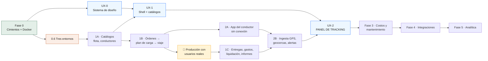

# Plan de construcción — FleetFuel Control

Del contenedor Docker a la implementación del panel de tracking, fase por fase.

**Versión:** 1.0 · **Fecha:** 2026-08-30 · **Ámbito:** Alcaldía de Panamá

## De dónde sale este plan

Este documento no inventa alcance. Reordena y hace ejecutable lo que ya está
decidido en tres fuentes, y cuando las tres se contradicen lo dice en voz alta:

| Fuente | Qué aporta | Dónde |
|---|---|---|
| Arquitectura §19 «Secuencia de construcción» | Las 6 fases, sus duraciones y el orden interno de la Fase 1 | `architec-cisterna.html#/arquitectura/fases` |
| PRD §26 «Implementación por fases» | Los módulos de negocio de cada fase | `documentos.html#cisterna.md` |
| Spec UX/UI · Panel de Tracking v1.0 | 24 fichas de componente, tokens, estados, modelo de datos | `#/spec/ux-tablero` (34 fichas) |
| `README.md` de este repo | Lo que la Fase 0 ya entregó | `/home/app/fleetfuel/README.md` |

Consola completa: <http://10.0.0.193:8000/>

---

## Cómo se lee y cómo se sigue

Cada fase trae cuatro cosas, y **las cuatro son obligatorias**:

- **Puerta de entrada** — lo que tiene que ser cierto para empezar. Si no se
  cumple, la fase no arranca; no se «arranca en paralelo mientras tanto».
- **Entregables** — casillas marcables. Es el checklist de trabajo.
- **Criterio de salida** — cómo se demuestra que terminó, con el comando que lo
  prueba. Una fase sin criterio de salida verificable no está terminada, está
  abandonada.
- **El riesgo de esta fase** — el modo de fallo concreto, no una lista genérica.

Estados: `✅ hecho` · `🟡 parcial` · `⬜ pendiente` · `🚧 bloqueado`

---

## El punto que le da forma a este plan

La petición natural es «de Docker hasta el UX/UI», en línea recta. **No se puede.**

El modelo de datos del spec (`#/spec/ux-modelo-datos`) define un `Shipment` con
cinco bloques, y cada uno nace en una fase distinta:

```
Shipment {
  id, status, partnerId, partnerName   →  Fase 1A/1B  (clientes, viajes)
  vehicle { capacityPct, overloaded }  →  Fase 1A     (vehículos, cisternas)
  driver  { chatChannelId, lastSeenAt }→  Fase 1A + 2 (conductores + chat)
  eta     { remainingSec, delaySec }   →  Fase 2      (necesita GPS real)
  route   { stops, polyline }          →  Fase 1B/1C  (plan de carga, entregas)
  telemetry { lat, lng, stale }        →  Fase 2      (posiciones_gps)
  photos  PhotoReport[]                →  Fase 2      (fotografías del conductor)
  requests RouteRequest[]              →  Fase 2      (NO existe en el PRD ⚠)
}
```

De ahí salen las dos consecuencias que estructuran todo lo demás:

**1. El panel de tracking no puede ir al final.** Si se deja para después de la
Fase 5, hay tres fases enteras sin una sola pantalla y el §19 ya advierte a qué
sabe eso: *«un mes que no produce ninguna pantalla visible, y por eso suele
recortarse»*. Por eso hay **dos carriles**: producto/backend y UX/UI, con
compuertas explícitas entre ellos.

**2. El panel de tracking tampoco puede ir al principio.** Sin `posiciones_gps`
no hay punto azul en el mapa, sin `viajes` no hay tarjetas y sin entregas no hay
paradas. Lo que **sí** se puede adelantar es todo lo que no depende de datos: los
tokens, los 24 componentes con sus estados, los skeletons y el recorrido de
teclado. Eso es la Fase UX-0, y corre en paralelo desde el día uno.

### Mapa de dependencias



La compuerta 🏁 es del §19 y es innegociable: **1B llega a producción con
usuarios reales antes de que empiece 1C.** *«Un recorrido operativo completo y en
uso enseña más sobre lo que falta que tres módulos a medio terminar.»*

---

## Estado al 2026-09-06

| Fase | Duración §19 | Estado | Comentario |
|---|---|---|---|
| 0 · Cimientos | 30 d | ✅ **cerrada** | 2026-09-06. Los tres entornos en pie, observabilidad recogiendo y respaldos verificándose solos |
| UX-0 · Sistema de diseño | ~15 d | 🟢 **código completo** | 24/24 componentes, contraste AA en CI. Falta Noka y la revisión humana |
| 1A · Catálogos | 25 d | ✅ **cerrada** | Criterio de salida verificado DESDE LA UI: alta de cliente, conductor, vehículo y cisterna con compartimentos, las cuatro en auditoría |
| UX-1 · Shell y catálogos | — | 🟢 **código completo** | 3 columnas, 5 breakpoints, estado en la URL, CRUD de los 6 catálogos |
| 1B · Órdenes → viaje | 35 d | 🟢 **código verificado** | 5 tablas, exclusiones del §5.1, 14 rutas, 16 pruebas y el flujo completo recorrido desde la UI. Falta solo la compuerta de producción |
| 1C · Entregas, liquidación | 30 d | 🟡 **parcial** | Entregas y conciliación de volúmenes construidas y probadas (2026-09-07). Gastos, liquidaciones e informes siguen tras la compuerta 🏁 |
| 2A · App del conductor | 45 d | ⬜ | |
| 2B · GPS, geocercas, alertas | 30 d | ⬜ | |
| UX-2 · Panel de tracking | ~35 d | ⬜ | Compuerta dura: 2B |
| 3 · Costos y mantenimiento | 55 d | ⬜ | |
| 4 · Integraciones | 45 d | ⬜ | |
| 5 · Analítica | 40 d | ⬜ | |

Repositorio: `main` en `67acab8`, respaldado en
`git@github.com:JosueObando/fleetfuel.git` (privado).

**FleetFuel se sirve en <https://fleetfuel.jop.lat>** desde el 2026-09-06, con
TLS válido, un solo origen y el login con freno de fuerza bruta y registro de
intentos fallidos. Verificado de extremo a extremo: `/entrar` 200 en
25 ms, `/api/salud` con `postgres: ok` y `redis: ok`, los chunks del bundle
200, el 80 redirigiendo con 301, y `POST /api/auth/login` devolviendo 401 con
credenciales falsas. Los puertos 4200 y 3200 ya **no** son alcanzables desde la
LAN; el 4100 de desarrollo sigue abierto a propósito.

**Producción está levantada** en esta misma máquina desde el 2026-09-04, con
sus cuatro servicios sanos y separados de desarrollo en nombre, volúmenes, red
y puertos (4200/3200 frente a 4100/3100). La base y Redis no se publican.

**1A queda cerrada el 2026-09-04.** Su criterio de salida se verificó donde
lo pide el §26 —desde la interfaz, no por API— con el recorrido automatizado
`frontend/e2e/recorrido.mjs`: entra por la pantalla de login y da de alta un
cliente, un conductor, un vehículo y una cisterna con dos compartimentos. Las
cuatro altas quedan en `auditoria` con autor y hora, y el navegador no reporta
ningún error de consola.

**De UX-0 sigue faltando lo que necesita una persona:** los `.woff2` de Noka
(los títulos caen en Montserrat) y el recorrido del kit junto al spec.

En marcha: `http://10.0.0.193:3100` (interfaz) · `:4100/api` (API) ·
`:8000` (portal de documentos).

---

# FASE 0 · Cimientos y Docker

> **Objetivo.** Las cinco garantías que el §19 llama *«las cinco cosas más caras
> de añadir tarde en todo el proyecto»*. No produce ninguna pantalla.

**Puerta de entrada:** ninguna. Es el arranque.

### 0.1 · Docker y entorno de desarrollo — ✅

- [x] `docker-compose.yml` con backend, Postgres 16 + PostGIS 3.4 y Redis 7
- [x] `Dockerfile` multietapa, con `target: development` que conserva
      devDependencies y `src/` — es lo que permite correr seeds y pruebas de
      integración *dentro* del contenedor
- [x] `.env.example` con los secretos separados de `.env`

```bash
cd /home/app/fleetfuel
sg docker -c "docker compose up -d --build"
sg docker -c "docker compose exec backend npm run seed"
curl -s localhost:4100/api/salud | jq
```

> El usuario `app` está en el grupo `docker` pero la sesión es anterior al
> cambio: hay que envolver con `sg docker -c "…"`. `sudo` pide contraseña
> interactiva.

### 0.2 · Esquema multiempresa con RLS — ✅

- [x] `empresa_id` en toda tabla de negocio, con política RLS (ADR 003)
- [x] **Dos roles de base de datos**: `DATABASE_USER` (dueño, migra) y
      `DATABASE_APP_USER` (sujeto a RLS, sin `DELETE`). En Postgres el dueño de
      una tabla evade sus propias políticas: conectar la app como dueño anularía
      el aislamiento **sin un solo síntoma**. `main.ts` lo comprueba al arrancar
      y se niega a levantar
- [x] `fn_login_resolver` como `SECURITY DEFINER` — el login necesita saber la
      empresa antes de tener contexto, y esta función devuelve sólo eso
- [x] Verificado: 8 tablas con política; `migrations`, `permisos` y
      `spatial_ref_sys` sin ella, correctamente

### 0.3 · Auth, RBAC y MFA — ✅

- [x] JWT: acceso 15 min / refresco 7 días revocable en Redis
- [x] RBAC con permisos granulares, **sin rol de paso libre** — deliberado: el
      riesgo del negocio no es el robo de datos sino el *fraude de volumen* (§7),
      y la separación entre quien captura la carga y quien captura la entrega
      desaparece en cuanto un rol puede hacerlo todo
- [x] MFA TOTP obligatorio para Administrador, Finanzas y Auditor, con sesión de
      inscripción restringida (sin `refreshToken`, por diseño)
- [x] Registro y revocación remota de dispositivos

### 0.4 · Auditoría e idempotencia — ✅

- [x] Interceptor global → tabla append-only (§21, §4)
- [x] `Idempotency-Key` obligatoria en todo `POST`, con huella del cuerpo
      (ADR 004). Excepciones explícitas con `@SinIdempotencia()`

### 0.5 · CI con Postgres real — ✅

- [x] `.github/workflows/ci.yml` ejecutado paso a paso en clúster limpio,
      incluido `migration:revert`

### 0.6 · Los tres entornos — ✅ **5 de 5**

- [x] Servidor de **prueba** provisionado — 2026-09-06, replanteando lo que
      este documento daba por imposible: `docker-compose.prueba.yml`, puertos
      4300/3300, base, volúmenes y secretos propios
- [x] Servidor de **producción** — redefinido el 2026-09-04 a esta misma
      máquina; compose propio levantado y verificado de extremo a extremo
- [x] **Respaldo** automático de Postgres con restauración probada —
      `ops/respaldo-postgres.sh`, diario a las 02:00 por timer de systemd,
      rotación 7+4. Falta el destino fuera de este host (ver los bloqueos)
- [x] Nginx + Let's Encrypt como reverse proxy (§8: «nuevo») — cerrado el
      2026-09-06: host creado en NPM, TLS del comodín, puertos cerrados a la LAN
- [x] Observabilidad: **Grafana + Loki + Prometheus** (§8) — autoalojada,
      2026-09-06. `docker-compose.observabilidad.yml` y `ops/observabilidad.md`

> **Nginx, al 2026-09-06.** Decidida la topología de **un solo origen**: el
> frontend en `/` y la API en `/api` bajo el mismo host. `NEXT_PUBLIC_API_URL`
> pasó de `http://10.0.0.193:4200/api` a `/api` y el frontend se reconstruyó:
> verificado que la IP absoluta ya no aparece en el bundle. Sin eso el proxy
> habría sido decorativo, porque esa URL se hornea en el JavaScript del
> navegador y el cliente habría seguido llamando al 4200 directamente.
>
> La configuración está escrita en `ops/nginx-fleetfuel.conf` y **aplicada**
> en el NPM de 10.0.0.19 según `ops/proxy-inverso.md`: el host reenvía `/` al
> 3200 y una Custom Location `/api` al 4200, sin `Cache Assets`.
>
> **Let's Encrypt sí es posible, y ya está en marcha.** Corregido el
> 2026-09-06: en el NPM hay un comodín `*.jop.lat` de Let's Encrypt válido
> hasta el 8 de noviembre de 2026, emitido por reto **DNS-01** —que solo
> comprueba un TXT en el DNS y nunca visita el servidor, así que la IP privada
> no estorba—. `fleetfuel.jop.lat` ya resuelve y queda cubierto sin emitir
> nada. El descarte anterior razonaba sobre el reto HTTP-01, que sí exige
> alcanzabilidad; era un error.
>
> **Puerta trasera cerrada** el 2026-09-06 con `ops/cerrar-puertos-produccion.sh`
> y su unidad de systemd. No con `ufw`, que aquí **miente**: Docker mete su DNAT
> en PREROUTING y el tráfico va por FORWARD, mientras ufw trabaja en INPUT, así
> que el puerto seguiría abierto a toda la LAN y `ufw status` diría que está
> denegado. El enganche correcto es la cadena `DOCKER-USER`, emparejando con
> `conntrack --ctorigdstport` porque allí el DNAT ya ocurrió.
>
> **Y ahí hubo una segunda trampa, que dejó la URL pública colgada desde
> las 04:11 hasta que se diagnosticó.**
> `--ctorigdstport` identifica la CONEXIÓN, no el paquete: casa en los dos
> sentidos. El SYN del proxy pasaba, pero el SYN-ACK que el contenedor le
> devuelve sale con `src=172.19.0.x` —que no es 10.0.0.19— y la propia regla lo
> descartaba. La conexión se quedaba en `SYN_RECV` y la URL pública se colgaba
> **sin un solo error en ningún log**, porque un `DROP` no devuelve RST. El
> síntoma era idéntico a «el host de NPM no está creado», que era falso. Lo
> arregla `--ctdir ORIGINAL` (commit `67acab8`), que limita la regla al sentido
> de ida; el script purga la regla vieja antes de instalar la nueva, porque
> dejarla puesta anula el arreglo.
>
> **El freno del login, resuelto en el backend** (2026-09-06). El `limit_req`
> del proxy se había quitado con `--quitar-limite` para que el host de NPM
> cargara —la zona se declara dentro del CT y eso pide un `ssh root@` que desde
> aquí no autentica—, y detrás no había nada. Verificado entonces: **42
> intentos seguidos, 42 respuestas 401, ni un 429, ni una línea en ningún
> registro.**
>
> Se eligió resolverlo en el backend y no en el proxy: es más lento que nginx,
> pero no depende del acceso al CT y no se pierde al recrear el host en NPM.
> Ver el bloqueo 3, cerrado.
>
> **El servidor de prueba SÍ lo da esta máquina** (2026-09-06). Este documento
> decía lo contrario, y era la misma clase de error que el descarte de Let's
> Encrypt: una conclusión heredada que nadie volvió a comprobar. Producción se
> redefinió a esta misma máquina el 04-09 y funciona; un tercer proyecto de
> Compose es mecánicamente lo mismo, y para un entorno de prueba la objeción de
> compartir disco pesa aún menos, porque sus datos son desechables por
> definición.
>
> Sirve para ensayar el despliegue antes de tocar producción: correr
> `migration:run` contra datos con forma y arrancar la MISMA etapa `production`
> de la imagen. Hoy ese ensayo se hacía en producción, que es donde no se debe
> descubrir que una migración falla. Construye con etiqueta `:prueba` y no
> reutiliza `:prod`: compartirla haría que reconstruir para probar cambiara, en
> silencio, la imagen que producción levantaría en su siguiente reinicio.
>
> **Lo único que no reproduce** es el origen único: sin proxy delante, su
> bundle lleva la URL absoluta y por tanto sí hay CORS, donde producción no
> tiene. Un fallo de CORS es de los pocos que este entorno no puede atrapar.
> Se arregla creando `prueba.jop.lat` en el NPM, que el comodín ya cubre.

> **Observabilidad, cerrada el 2026-09-06.** Grafana + Loki + Prometheus
> autoalojados, unos 400 MB de RAM. Se descartó Sentry + Better Stack: los
> registros llevan correos, IPs y cuerpos de error, y sacarlos de la red es una
> decisión que este sistema no necesita tomar.
>
> Lo primero que hubo que arreglar fue que **el backend no registraba ni una
> petición HTTP** —214 líneas en producción, todas de arranque—. Ahora cada una
> deja una línea JSON con su `idPeticion`, que vuelve al cliente en
> `X-Request-Id`. Nunca el cuerpo: el del login lleva la clave y el TOTP. Y lo
> genera un *middleware*, no un interceptor, porque cuando un guard rechaza
> —el 401 del JWT, el 429 del freno— la excepción sube y el interceptor no
> llega a correr: justo el tráfico que más interesa sería el único invisible.
>
> **Queda fuera, con motivo:** las métricas por contenedor. cAdvisor es
> incompatible con el almacenamiento de Docker 29 y producía métricas
> etiquetadas con el cgroup en crudo en vez del nombre — datos correctos e
> ilegibles. Detalle completo en `ops/observabilidad.md`.
>
> **Nueve alertas** (2026-09-06), aprovisionadas por fichero: producción caída,
> un entorno interno caído, certificado a menos de 21 días, respaldo fallido
> esta noche, respaldo sin terminar bien en 26 h, disco >85 %, memoria <10 %,
> 5xx sostenidos y el freno del login mordiendo. Verificadas parando el backend
> de desarrollo: disparó a los 6 minutos y se resolvió sola al restaurarlo.
>
> Las dos del respaldo forman escalera a propósito: aviso la misma noche por
> `fleetfuel_respaldo_exito`, y crítica al día siguiente por antigüedad. La
> segunda cubre además lo que la primera no puede —el timer parado o la máquina
> apagada—, porque en esos dos casos la métrica no se escribe y no hay fallo que
> detectar, sólo una ausencia.
>
> Dos decisiones que las sostienen. Las **sondas van desde fuera**, por la misma
> URL que usa un usuario, y recorren DNS, proxy, TLS, cortafuegos y aplicación:
> es lo que habría visto el cuelgue de esta mañana, que ningún healthcheck
> interno vio porque el backend estaba sano. Y el **respaldo afirma su éxito**
> con una métrica en vez de que se busque la ausencia de un error en los
> registros — la ausencia también se produce con el timer parado o la máquina
> caída, y en los tres casos parece que todo va bien.
>
> **El canal, cerrado** (2026-09-06): ntfy autoalojado en el 3450, con un
> traductor de treinta líneas en medio porque Grafana no deja dar forma al
> cuerpo de un webhook y, conectado directo, al móvil llegaba su JSON en crudo.
> Se descartó el correo (no hay SMTP) y los tipos de contacto nativos que llegan
> a un móvil (Telegram, Discord, Slack, Pushover) por ser todos de terceros — el
> mismo motivo por el que la observabilidad entera es autoalojada.
>
> Verificado extremo a extremo parando el backend de desarrollo: disparó a los
> 5 min y la notificación llegó a los 6 con título, causa y qué mirar; al
> restaurarlo llegó la resolución con prioridad baja, que no despierta a nadie.
>
> Por el camino apareció un fallo que la propia prueba habría tapado: el título
> viajaba en una cabecera HTTP, que no es UTF-8, y las seis alertas con tilde
> llegaban como «Producci<?>n no responde» — con ntfy respondiendo 200, así que
> no había rastro en ningún registro. La alerta elegida para probar era una de
> las dos sin tilde. Se arregló publicando por cuerpo JSON.

### 0.7 · Respaldo del repositorio — ✅ (2026-09-03)

- [x] Remoto de git configurado y `push` verificado
- [x] `fase-0-cierre` fusionada a `main`

> Cerrado el 2026-09-03. Remoto privado en `JosueObando/fleetfuel`, autenticado
> con llave ed25519 propia del repositorio (`~/.ssh/id_ed25519_fleetfuel`, con
> `IdentitiesOnly` en `~/.ssh/config`) y la host key de GitHub verificada contra
> la huella publicada. `fase-0-cierre` se fusionó a `main` por fast-forward y se
> subió: `main` = `c8b00f4`, 3 commits, local y remoto idénticos.
>
> Este documento estaba **fuera de git** hasta el mismo cierre. Antes de subir
> se verificó que `.env` está en `.gitignore` y nunca entró al historial, y que
> ningún archivo versionado trae credenciales.

**Criterio de salida de la Fase 0**

```bash
sg docker -c "docker compose exec -T backend npm run typecheck"        # 0 errores
sg docker -c "docker compose exec -T backend npm test"                 # 0 fallos
sg docker -c "docker compose exec -T backend npm run test:integracion" # 0 fallos
curl -sf http://localhost:4300/api/salud                               # 200 en PRUEBA
curl -sf https://fleetfuel.jop.lat/api/salud                           # 200 en PRODUCCIÓN
git remote -v && git push origin main                                  # remoto vivo
```

**Ejecutado el 2026-09-06:** typecheck limpio, 54 pruebas unitarias y 53 de
integración en verde, los tres entornos respondiendo y el remoto al día.

**El riesgo de esta fase era** darla por cerrada con 4 de 5 — las fases
siguientes producen pantallas, la presión por avanzar aumenta y el 0.6 no se
vuelve más fácil, sólo más caro. No se corrió: se cerró entera antes de
empezar 1C.

---

# FASE UX-0 · Sistema de diseño

> **Objetivo.** Convertir el spec en código que compila, **antes** de que existan
> datos que pintar. Todo lo aquí listado se puede construir con datos falsos.

**Puerta de entrada:** ninguna — corre en paralelo con 0.6 y 1A.

### Entregables

- [ ] Proyecto Next.js 16 + React 19 + TypeScript 5.6 (§8 «Stack recomendado»)
- [ ] **Tokens como variables CSS** (`#/spec/ux-tokens-color`), en la columna
      MUPA, no en la del original oscuro:
      `--action #0660FF` · `--bg-base #F4F6F7` · `--bg-surface #FCFDFD` ·
      `--fg-strong #21252B` · `--fg-default #363B43` · `--fg-muted #627485` ·
      `--border-subtle #D9D9D9` · éxito `#2ECC71` · aviso `#F59E0B` · error `#E53935`
- [ ] Escala tipográfica, radios y transiciones (`#/spec/ux-tokens-forma`).
      Radios MUPA: `--radius-sm 8` inputs y chips · `--radius-card 16` tarjetas ·
      `--radius-pill` botones — **los botones MUPA son pastilla, no radio 8**
- [ ] Tipografía a dos voces: **Noka** sólo en títulos e ID de envío,
      **Montserrat** en todo lo demás. **Nunca Prometo en UI**
- [ ] Los **24 componentes** de las fichas, cada uno con sus 6 estados
      (reposo, hover, foco, activo, deshabilitado, cargando):
  - [ ] Chrome y navegación (5): `BrandBlock` `NavItem` `NavGroup` `IconToolbar` `DashedCTA`
  - [ ] Panel de tracking (8): `PanelHeader` `FilterChip` `SegmentedControl` `ShipmentCard` `StatusBadge` `MetricStack` `RouteTimeline` `VehicleThumb`
  - [ ] Panel de detalle (11): `DetailHeader` `Button` `Tabs` `CapacityGauge` `SectionHeader` `MapView` `MapControl` `PhotoStrip` `PhotoCard` `ActionTile` `RequestList`
- [ ] Iconos UIcons Rounded vía componente `Icon`: 20 px en nav, 16 px en botones
- [ ] **Skeletons por panel, no globales** (`#/spec/ux-estados-pantalla`):
      6 tarjetas con bloques de 12/60/72 px y shimmer de 1.2 s. Sin spinner de
      página. Si pasa de 3 s, «Cargando la flota…» debajo
- [ ] Copy en español de Panamá, trato de tú, orientado al resultado:
      «Seguimiento», «Filtrar por socios», «Llamar al conductor», «Cambiar ruta»
- [ ] Accesibilidad (`#/spec/ux-accesibilidad`): contraste verificado —
      **incluida la corrección de `fg-tertiary`**—, recorrido de teclado completo
      sin trampas de foco, regiones vivas, `prefers-reduced-motion`
- [ ] Storybook (o equivalente) con los 24 × 6 estados navegables

**Criterio de salida**

- [ ] Un revisor abre el kit junto a `#/spec/ux-tablero` y recorre los 23 globos:
      cada uno tiene su componente construido y sus 6 estados visibles
- [ ] Auditoría de contraste automatizada en CI, 0 fallos AA
- [ ] Recorrido de teclado grabado de extremo a extremo, sin trampas

**El riesgo de esta fase:** construir los componentes con el tema **oscuro** del
original. El spec trae una columna MUPA entera (`#/spec/ux-equivalencias-mupa`)
precisamente porque dentro del ecosistema municipal el tema es **claro por
defecto**, con jerarquía por sombras azuladas en vez de por luminancia. Repintar
24 componentes después es rehacerlos.

---

# FASE 1 · Control operativo

> **Objetivo.** El recorrido operativo completo: de la orden al viaje, y del
> viaje a la liquidación. Es la fase que convierte el sistema en algo usable.

## 1A · Catálogos, flota y conductores — 25 d

**Puerta de entrada:** Fase 0 cerrada **incluido 0.6**.

- [ ] Clientes · Estaciones · Productos
- [ ] Vehículos · Cisternas (con compartimentos y capacidad por compartimento)
- [ ] Conductores (con licencia, vencimientos y calibración)
- [ ] Habilitar `btree_gist` para las restricciones de exclusión del §5.1 — la
      Fase 0 ya dejó la extensión puesta pero no la usa
- [ ] Cada `POST` con `Idempotency-Key`; cada entidad con `empresa_id` y RLS
- [ ] Permisos de negocio añadidos a los 12 roles del §5

**Criterio de salida:** un operador da de alta una cisterna con sus
compartimentos, un conductor y un cliente desde la UI, y la auditoría registra
las tres altas con autor, fecha y valores.

## UX-1 · Shell de la aplicación y pantallas de catálogo

**Puerta de entrada:** UX-0 terminada · 1A con endpoints vivos.

- [ ] Layout de tres columnas (`#/spec/ux-layout`): sidebar 228 px fijo ·
      Tracking 540 px · Detalle 672 px flexible (`flex:1`, mínimo 560).
      **La ventana no scrollea**; scrollean sólo los dos paneles
- [ ] Sidebar colapsado a 72 px por debajo de 1280
- [ ] Los 5 breakpoints (`#/spec/ux-responsive`): ≥1600 · 1280–1599 ·
      1024–1279 · 768–1023 maestro/detalle conmutado · <768 tab bar de 5 destinos
- [ ] CRUD de catálogos sobre los componentes de UX-0
- [ ] **Estado de la vista reflejado en la URL** —
      `?partners=a,b&show=active&selected=SD-…` — para que sea compartible y
      recargable sin pérdida de estado

**Criterio de salida:** el shell aguanta los 5 breakpoints con datos reales de
catálogo y la URL restaura la vista exacta tras recargar.

## 1B · Órdenes → plan de carga → viaje — 35 d

**Puerta de entrada:** 1A cerrada.

- [ ] Órdenes
- [ ] Plan de carga, con asignación por compartimento
- [ ] Viajes, con la máquina de estados del §8 del PRD
- [ ] Restricción de exclusión: una cisterna o un conductor **no pueden estar en
      dos viajes que se superpongan** (§5.1)
- [ ] Motor de cálculo y control de concurrencia (§16 de arquitectura)

### 🏁 COMPUERTA · Producción con usuarios reales

**No se empieza 1C hasta que esto sea cierto.** Es una instrucción literal del
§19, no una recomendación.

- [ ] `orden → plan de carga → viaje` desplegado en **producción**
- [ ] Usuarios reales de la Alcaldía operando viajes reales
- [ ] Al menos 2 semanas de operación, con los defectos encontrados triados

> *«El módulo de liquidaciones se diseña mucho mejor cuando ya existen viajes
> reales que liquidar.»*

## 1C · Entregas, gastos, liquidación e informes — 30 d

**Puerta de entrada:** la compuerta 🏁 superada.

- [x] **Entregas** — §7.14 completa, 5 rutas, 25 pruebas (2026-09-07)
- [ ] Evidencia fotográfica y documentos de la entrega — llega con 2A, que es
      donde el conductor captura evidencias (§5)
- [ ] Gastos
- [ ] Liquidaciones, con los cálculos del §10
- [x] **Conciliación de volúmenes** (§17) y merma con tolerancia — §10.4 y §10.5
- [ ] Reportes básicos (§14)

### Por qué esta parte se adelantó a la compuerta, y el resto no

La compuerta protege lo que la operación real puede cambiar de forma. El §19 lo
dice de las liquidaciones —«se diseñan mucho mejor cuando ya existen viajes
reales que liquidar»— y el apartado de riesgo de abajo avisa del coste de
rehacerlas.

**Las entregas no son eso.** Sus campos son los del §7.14 uno a uno, sus
fórmulas las del §10.4 y §10.5, y su comportamiento las reglas 7, 8, 9 y 20 del
§11. Nada de eso se aprende operando: está escrito. Lo que sí espera son gastos,
liquidaciones e informes, que son justo donde la operación enseña.

Una decisión de diseño que conviene conocer antes de tocar el módulo: **no se
bloquea recibir más volumen del que se cargó.** Los medidores de la terminal y
de la estación no coinciden nunca al litro, y rechazar la lectura obliga a quien
captura a redondear hasta que el sistema la acepte. Eso no evita el descuadre,
lo BORRA — y el descuadre es la señal de fraude de volumen que el §7 llama el
riesgo principal de este negocio. Se acepta, se calcula la merma (en valor
absoluto, para ver los dos lados) y la regla 9 la manda a aprobación de otro
rol. El único tope duro es el de la regla 20, y vive en la base.

**Criterio de salida:** un viaje real recorre orden → carga → entrega →
liquidación y cuadra contra la conciliación de volúmenes, con la merma dentro de
tolerancia y la diferencia justificada en auditoría.

**El riesgo de la Fase 1:** construir 1C en paralelo con 1B «para ganar tiempo».
Es exactamente lo que el §19 desaconseja, y el coste no se ve hasta que hay que
rehacer liquidaciones contra un modelo de viaje que la operación real cambió.

---

# FASE 2 · Móvil y GPS

> **Objetivo.** Los datos que el panel de tracking necesita para existir.

## 2A · App del conductor sin conexión — 45 d

**Puerta de entrada:** 1B cerrada.

- [ ] React Native + Expo (§8)
- [ ] SQLite local (`expo-sqlite`) + **cola de salida**
- [ ] Sincronización idempotente contra la infraestructura del ADR 004 — la
      Fase 0 ya dejó la firma de todo `POST` preparada para esto
- [ ] Checklists · Fotografías · Firma digital

## 2B · Ingesta GPS, geocercas y alertas — 30 d

**Puerta de entrada:** 2A con conductores reales enviando datos · 1C cerrada.

- [ ] Tabla `posiciones_gps` **particionada por mes** (§5.2) — preparada en Fase 0
- [ ] Ingesta por WebSocket, cadencia de 5 s (`#/spec/ux-modelo-datos`)
- [ ] Polling de respaldo de la lista completa cada 60 s
- [ ] Marca `stale` en telemetría, para el banner de telemetría caída
- [ ] Geocercas
- [ ] Las 8 alertas del §22: desvío de ruta, exceso de velocidad, parada no
      autorizada, pérdida de GPS, sello inconsistente, diferencia de volumen,
      merma sobre tolerancia, vencimientos

### 2C · Solicitudes de cambio de ruta — 🟡 decidido y construido a medias

**No está en el PRD.** Se decidió el 2026-09-07: entra.

El spec define `RouteRequest { type: "detour"|"extra_stop"|"cancel", requestedBy,
reason, state: "pending"|"approved"|"rejected", resolvedBy, resolvedAt }` y el
componente `RequestList` con aprobación y rechazo en línea. En el PRD, «Desvío»
aparece **sólo como alerta detectada** (§22) y como evento del flujo (§9): es
reactivo, no un flujo de aprobación.

También aparece `driver.chatChannelId` en el modelo y un botón de chat en
`MapControl`. **La palabra «chat» no existe en el PRD.**

- [x] **Decisión tomada el 2026-09-07: los dos entran al alcance.**
- [x] `RouteRequest` — tabla `solicitudes_ruta`, 5 rutas, 15 pruebas de servicio
      y el recorrido HTTP. Los tres tipos del spec (`detour`, `extra_stop`,
      `cancel`) y sus tres estados
- [x] Permisos `solicitudesruta:leer/crear/resolver`, repartidos
- [ ] Notificación a la app del conductor — **necesita la Fase 2A**, que es
      donde esa app existe. Lo que falta es el aviso, no el modelo
- [x] Chat · `conductores.canal_chat`, que es LO ÚNICO que el spec define
- [ ] Chat · **el transporte sigue sin decidir**, y sin eso no hay nada más que
      construir. Ver abajo

### La regla que hace que `RouteRequest` sea un control y no un formulario

**Quien pide no resuelve**, y va además del permiso: el permiso dice qué puede
hacer un ROL, y la regla dice qué no puede hacer una PERSONA con su propia
solicitud. Un despachador que pide un desvío sigue sin poder aprobárselo aunque
su rol resuelva los de los demás. Sin eso, «solicitud de cambio de ruta» es el
conductor autorizándose el desvío y la traza que deja no prueba nada.

El reparto lo refleja: el **Conductor** pide —es quien está en la carretera y ve
el problema— y el **Despachador** y el **Supervisor de operaciones** resuelven,
que es literalmente lo que el §5 les asigna.

Y no sustituye a la alerta de desvío del §22: aquella es reactiva —el sistema se
entera de que el camión se salió— y ésta es un permiso pedido de antemano. El
desvío que nadie pidió sigue siendo el que más interesa vigilar.

### Chat: lo que el spec NO dice, y por eso queda abierto

El spec pide `driver.chatChannelId` y un botón en `MapControl`. **Eso es todo:**
no define mensajes, ni almacenamiento, ni transporte, ni quién puede escribir a
quién. El identificador está construido —es el mismo campo en cualquiera de los
caminos posibles— pero lo que falta no es código, es una decisión:

1. **Enlace a una mensajería existente** (WhatsApp, Telegram). El campo guarda
   un enlace, el botón lo abre y FleetFuel no almacena ni un mensaje. Es lo más
   barato con diferencia, y lo que ya usa media flota del país. A cambio, la
   conversación queda FUERA de la auditoría del §21 — y en un sistema cuyo
   riesgo declarado es el fraude de volumen, «cámbiame la ruta, te lo digo por
   WhatsApp» es exactamente lo que no debería quedar sin rastro.
2. **Mensajería propia dentro de FleetFuel.** Entra en la auditoría y se ata a
   los permisos, pero es un subsistema entero: tabla de mensajes, tiempo real,
   notificaciones, no leídos, adjuntos. No cabe en 2C; es una fase.
3. **Ninguna de las dos: el botón se quita del spec.** Si toda instrucción al
   conductor tiene que ser auditable, `solicitudes_ruta` ya cubre el caso de
   uso real —pedir y autorizar un cambio— y el chat sobra.

Mi recomendación es la **3 para el panel v1** y decidir entre 1 y 2 cuando la
app del conductor (2A) exista y se sepa qué se necesita decirle de verdad. Un
botón dibujado que abre WhatsApp es la opción que parece gratis y deja la
decisión tomada sin que nadie la tome.

**Criterio de salida de la Fase 2:** un conductor real recorre un viaje con la
app sin cobertura durante un tramo, la cola de salida se drena al recuperar
señal sin duplicar nada, y `posiciones_gps` tiene la traza completa.

---

# FASE UX-2 · Panel de Tracking

> **Objetivo.** La pantalla del spec, con datos reales. Es el entregable que
> cierra el arco completo del plan.

**Puerta de entrada — las cuatro, sin excepción:**

1. UX-0 cerrada (los 24 componentes existen)
2. 1B cerrada (hay viajes que listar)
3. 1C cerrada (hay paradas y entregas para el timeline)
4. 2B cerrada (hay telemetría que pintar)

### Entregables

- [ ] Panel de tracking: `PanelHeader`, `FilterChip` por socio con contador del
      servidor, `SegmentedControl` All/Active/Inactive
- [ ] Lista de `ShipmentCard` con **scroll infinito en páginas de 20**
- [ ] Panel de detalle: `DetailHeader`, `Tabs` de 5 vistas, `CapacityGauge` sobre
      la silueta del vehículo, `PhotoStrip` + `ActionTile`
- [ ] `MapView` con Leaflet 1.9 (§8): ruta, posición actual, nodos de parada y
      encuadre automático
- [ ] Cronómetros de ETA **interpolados en cliente** entre actualizaciones
- [ ] Los 6 estados de pantalla con su copy exacto (`#/spec/ux-estados-pantalla`):
      carga · lista vacía · filtro sin resultados · sin selección · error de
      carga por panel · telemetría caída
- [ ] **Nunca autoseleccionar** un envío en escritorio, salvo por deep link
- [ ] En error de carga: conservar el último dato válido **con marca de hora**
- [ ] Permisos en los 4 puntos de escritura: «Cambiar ruta», «Solicitar foto» y
      aprobar/rechazar exigen rol dispatcher. En rol viewer se muestran
      **deshabilitados con tooltip, no ocultos**
- [ ] `RequestList` — sólo si 2C se aprobó

### Criterio de salida — el checklist de handoff del spec

Las diez verificaciones de `#/spec/ux-handoff`, íntegras:

- [ ] Tokens de color y tipo publicados como variables CSS
- [ ] Los componentes con sus 6 estados en el kit
- [ ] Skeletons implementados **por panel**, no globales
- [ ] Contraste verificado, incluida la corrección de `fg-tertiary`
- [ ] Recorrido de teclado completo sin trampas de foco
- [ ] Estado de la vista reflejado en la URL
- [ ] Comportamiento con telemetría obsoleta probado
- [ ] Truncados verificados con datos máximos
- [ ] Fallback textual de la ruta cuando el mapa falla
- [ ] Permisos por rol validados en los 4 puntos de escritura

**El riesgo de esta fase:** el fallback del mapa. Es la única casilla del handoff
que exige que la pantalla siga siendo útil **cuando su elemento central no
carga**, y es la primera que se recorta cuando aprieta la fecha. Un panel de
operaciones sin fallback deja al despachador sin saber dónde está el camión
justo el día que el proveedor de tiles se cae.

---

# FASES 3 – 5

Con el arco cerrado, el resto es el §26 del PRD sin reordenar.

## Fase 3 · Costos y mantenimiento — 55 d
- [ ] Motor de costos y rentabilidad · costo por kilómetro · depreciación
- [ ] Mantenimiento preventivo y reparaciones
- [ ] Indicadores ejecutivos (§24)

## Fase 4 · Integraciones — 45 d
- [ ] Terpelo · terminal de carga · medidores · sensores
- [ ] Tarjetas de combustible · contabilidad · facturación

## Fase 5 · Analítica avanzada — 40 d
- [ ] Predicción de mantenimiento y de tiempos de entrega
- [ ] Optimización de rutas
- [ ] Detección de consumo anómalo y de posibles pérdidas
- [ ] Asignación automática de cisternas

---

## Trazabilidad: spec UX ↔ backend

Para revisar en cada corte que no se está construyendo pantalla sin dato ni dato
sin pantalla.

| Campo del `Shipment` | Origen en backend | Fase | Ficha del spec |
|---|---|---|---|
| `id`, `status` | `viajes` + máquina de estados §8 | 1B | `ux-shipmentcard`, `ux-statusbadge` |
| `partnerId`, `partnerName` | `clientes` | 1A | `ux-filterchip` |
| `vehicle.type`, `plate` | `vehiculos`, `cisternas` | 1A | `ux-vehiclethumb` |
| `vehicle.capacityPct`, `overloaded` | compartimentos + plan de carga | 1A/1B | `ux-capacitygauge` |
| `driver.*` | `conductores` | 1A | `ux-detailheader` |
| `driver.chatChannelId` | ⚠ **no existe en el PRD** | 2C | `ux-mapcontrol` |
| `driver.lastSeenAt` | telemetría | 2B | `ux-detailheader` |
| `eta.*` | cálculo sobre GPS | 2B | `ux-metricstack` |
| `route.stops`, `polyline` | plan de carga + entregas | 1B/1C | `ux-routetimeline` |
| `route.changedBy` | auditoría (§21) | 0 ✅ | `ux-routetimeline` |
| `telemetry.*`, `stale` | `posiciones_gps` particionada | 2B | `ux-mapview` |
| `photos[]` | fotografías del conductor | 2A | `ux-photostrip`, `ux-photocard` |
| `requests[]` | ⚠ **no existe en el PRD** | 2C | `ux-requestlist` |

Dos filas con ⚠. Ese es todo el alcance que el spec añadió sobre el PRD, y está
concentrado en un solo sitio a propósito: es más barato decidirlo ahora que
descubrirlo cuando `RequestList` ya esté maquetado.

---

## Los bloqueos: dos abiertos, uno cerrado

Los dos que quedan son decisiones, no código. El tercero apareció el 2026-09-06
al verificar el proxy y se cerró el mismo día, porque el sistema ya estaba
publicado y no podía esperar.

1. **Cómo se respaldan los datos.** *(parcial al 2026-09-04)* Ya existe el
   mecanismo: `ops/respaldo-postgres.sh`, diario a las 02:00 por timer de
   systemd, con verificación por restauración real y rotación 7+4. Lo que
   falta es el **destino fuera de este host**. El CT de nginx (10.0.0.19)
   comparte disco físico con esta VM, así que no sirve: una falla de ese
   disco se lleva original y copia. Queda aplazado por decisión del
   2026-09-04.
   Detalle original: Decidido el 2026-09-03 que desarrollo y
   producción vivirán en esta misma máquina, con sólo desarrollo por ahora. Eso
   resuelve el "dónde" del 0.6, pero traslada el peso al respaldo: hoy no existe
   ninguno de Postgres —sin cron, sin timer, sin dumps— y `db_data` es un volumen
   Docker sin copia. Con dev y prod compartiendo disco, el respaldo sustituye al
   aislamiento que se cede al no tener servidores separados. Falta decidir la
   ventana de pérdida tolerable y a dónde sale la copia, que debe salir de esta
   máquina.
2. **Si `RouteRequest` y el chat entran al alcance.** Bloquea a UX-2, pero se
   decide ahora porque cambia el modelo de datos de la Fase 2.

3. ~~**`POST /auth/login` no tiene ningún freno.**~~ **Cerrado el 2026-09-06**,
   las dos mitades. Se eligió el **backend** sobre el proxy: más lento que
   nginx, pero no depende del acceso al CT ni se pierde al recrear el host.

   - **Frenar** (`bb9ccbf`) — dos frenos con nombre, contados en Redis con un
     script Lua: `login-cuenta` 5/min por (IP, cuenta) y `login-ip` 30/min por
     IP, con bloqueo de 5 minutos. Son dos porque uno solo no vale: por IP a
     secas deja fuera a una oficina entera detrás de NAT, y por cuenta a secas
     se le escapa el barrido. En memoria tampoco valdría —el contador moriría
     con el proceso y el compose reinicia solo—, y en Lua porque
     `GET`+`INCR` desde Node deja huecos por los que pasan las peticiones
     concurrentes, que es la forma exacta del ataque.
   - **Ver** (`3d01520`) — tabla `intentos_login`, aparte de `auditoria` y por
     dos razones: `auditoria.empresa_id` es `NOT NULL` con RLS y un intento
     contra un correo inexistente no pertenece a ninguna empresa; y la
     auditoría se escribe *dentro* de la transacción de la petición para que se
     revierta si falla, que aquí es justo lo contrario de lo que hace falta. El
     rol de la aplicación tiene `INSERT` y **no** `SELECT`: escribe y no lee, y
     tampoco puede borrar.

   Verificado en producción por la URL pública: el intento queda registrado con
   la IP del **cliente** (10.0.0.193), no la del proxy — que es la prueba de
   que la cadena `trust proxy` → freno → registro está entera.

   Queda para cuando exista la pantalla: **cómo se consulta** el registro, con
   qué permiso y con qué visibilidad entre empresas. Hoy se lee con `psql`, que
   es lo que hace un operador mirando un ataque.

> **Cerrado:** el respaldo del repositorio (0.7), el 2026-09-03. El proxy
> inverso con TLS (0.6), el 2026-09-06.

---

*Fuentes: arquitectura §19 · PRD §26 · Spec UX/UI Panel de Tracking v1.0 ·
`README.md` de Fase 0. Consola: <http://10.0.0.193:8000/>*
